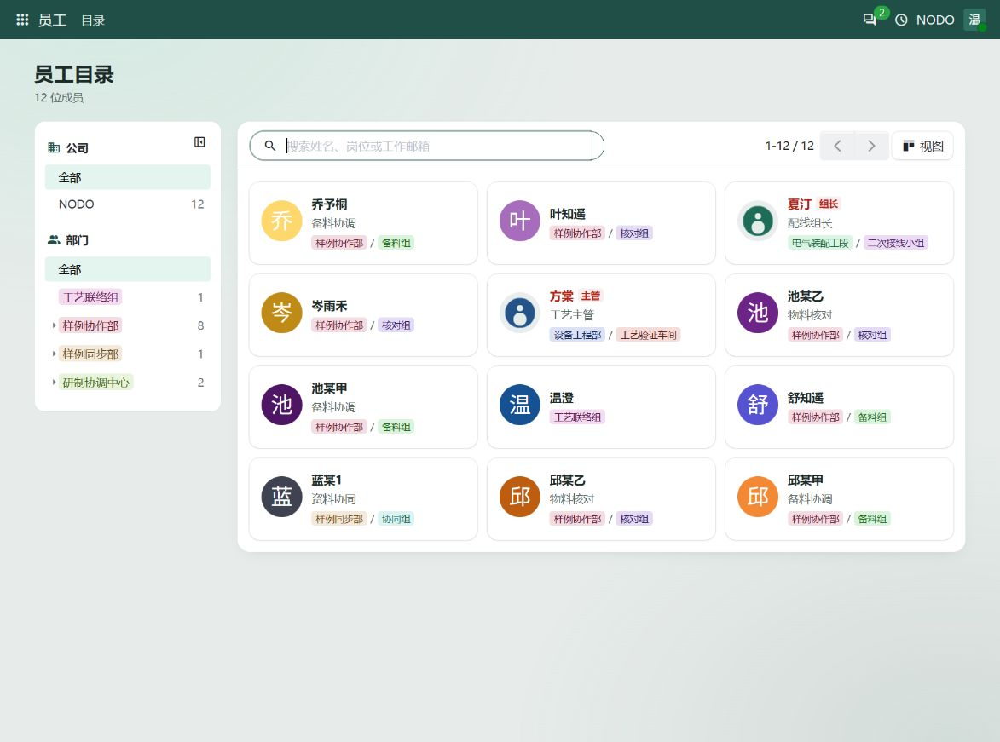
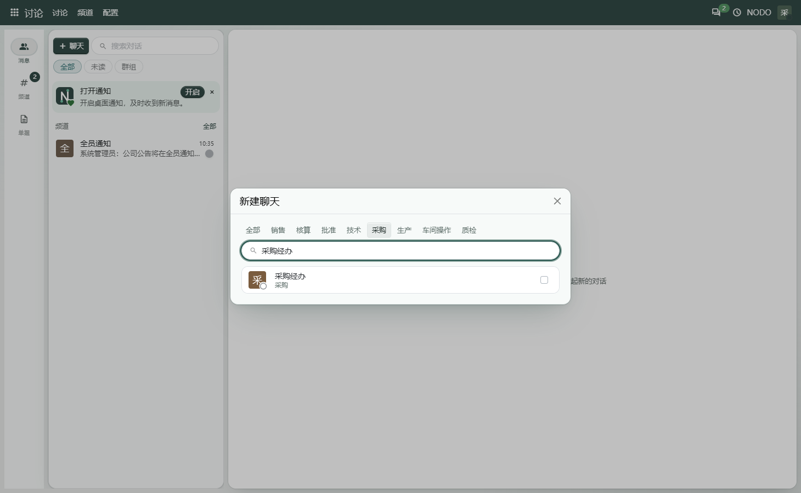

# 全员入门与讨论

适用 NODO 当前试点版本。2026-11-17 用员工账号核对应用入口、找同事、打开公告和通知设置。

## 第一次登录

1. 打开公司发给你的 NODO 地址，用分配给你的账号登录。
2. 桌面启用应用侧栏时，从左侧选择应用。点侧栏顶部的「展开应用侧栏」可看到组名和应用名称。使用主页菜单或窄屏时，从顶部菜单打开可用应用。
3. 点应用名进入，再从顶栏切换该应用下的功能。采购人员在「采购协作 → 采购单」处理采购单，员工聊天从「讨论」进入。
4. 在有搜索框的列表输入名称或编号，选择下拉提示中的搜索项。要换关键词，先去掉上次的搜索条件。
5. 修改表单后，点左上方的云朵上箭头图标。悬停会显示「手动保存」。单据保存后，查看单号和状态确认操作结果。

[桌面应用侧栏](../../验收/46-应用侧栏-02-改版后.jpg) · [主页菜单入口](../../验收/27-手册-01-应用入口.png)

## 快速跳转

启用新版应用侧栏后，点击左侧「快速跳转」，输入应用名、功能名或菜单路径，再点对应结果进入页面。普通员工可搜索「员工目录」或「讨论」。有管理权限的账号可搜索「员工名单」进入「员工 → 管理」，有员工计划权限的账号可直接搜索「员工计划」。

结果下方的路径可用来区分同名功能。设置页有未保存的更改时，点「留在此页」可回到原页面，保留刚才填写的内容和搜索词。[快速跳转弹窗](../../验收/47-快速跳转-02-改版后.png)

## 从员工目录找同事

1. 从应用侧栏或主页菜单打开「员工」，再点顶栏的「目录」。
2. 在搜索框输入姓名、岗位或工作邮箱，选择下拉搜索项。也可在左栏展开部门并点击名称。选中上级部门时会看到它及其下级成员。
3. 用右上方的箭头换页。点「视图」可以切换看板、列表和层级。
4. 点同事的卡片打开公开员工资料，查看完整部门路径及已填写的工作联系方式。

## 找同事与建群

1. 进「讨论」。左侧「消息」找私聊和群聊，「频道」找公共讨论，「单据」看所关注单据的讨论和提及。
2. 点「消息」列表上方带加号的「聊天」。
3. 在「新建聊天」里输入姓名，或者先点角色再搜索。例如点「采购」，再输入「采购经办」。
4. 选一人点「发起私聊」。选多人点「创建群聊」。打开私聊后，标题旁会显示对方的角色和在线状态。
5. 群聊可从顶部查看「成员」。需要改名、加人或离开时，用会话上的对应操作。

启用员工讨论接入后，搜索框也可输入部门或角色。用下方「部门」「角色」缩小结果，选择上级部门会包含下级。遇到同名员工，核对姓名下方的部门路径。点选后可在底部移除选中项。

## 使用频道

1. 在讨论左侧点「频道」，打开已经加入的频道。需要找其他频道时，用「浏览频道」，找到后点「加入频道」。
2. 「全员通知」用于公司公告。普通员工可以阅读和点表情。发布由频道的发言权限决定，当前默认包括系统管理员和获授权的批准角色。
3. 看到「本频道仅管理员可发言」时，该账号在这个频道处于只读状态。需要就公告补充内容，可以联系有发言权限的同事。
4. 工作用频道以已加入的列表为准。找不到应加入的频道时，先核对频道名，再联系负责该频道的管理员。

启用员工讨论接入后，进入可访问的频道，点「成员 → 添加成员」。在「添加频道成员」弹窗中查找并选中同事，点「添加到频道」。添加成功后在右侧成员名单核对。候选使用已开通且符合频道权限的内部账号。[添加频道成员](../../验收/45-讨论加人-02-改版后.jpg)

在「生产协调」交接缺料时，发消息写明物料和缺口，输入 `@` 选择负责的同事。接手人从未读入口打开频道，在原消息旁点「展开 → 回复」，说明处理进度和下一次反馈时间。后续结果继续在原频道交接。

## 发送与管理消息

| 要做的事 | 操作 |
|---|---|
| 输入多行说明 | `Shift + Enter` 换行，`Enter` 发送。 |
| 提醒会话里的某个人 | 输入 `@`，从候选中点选姓名，再写正文。 |
| 回应某条消息 | 在消息旁的操作菜单选「回复」或点表情回应。 |
| 修正刚发的消息 | 打开本人消息的操作菜单，选择「编辑」。默认时限为发出后 120 秒。 |
| 收回刚发的消息 | 时限内从同一菜单选「撤回」。会话中会留下撤回提示。 |
| 发图片或文件 | 在输入区选择文件，也可拖进会话或把截图粘贴到输入框。上传时可查看进度和取消。单文件默认上限 50 MB，以页面提示为准。 |
| 查看私聊是否已读 | 看自己最后一条可见消息下方的「已读」或「未读」。 |

## 在消息里引用单据

- 正在看报价单、销售订单或采购单时，可点表单上的「发到聊天」，选择同事或可发言的群聊、频道，填写附言后提交。成功提示中的「去看看」打开会话。
- 正在聊工作时，可在输入区使用「引用单据」，先选类型和记录，再发送消息。
- 点消息里的卡片打开单据。附言会随消息发送，单据内容由系统按接收人的权限显示。采购单的单价和金额也受接收人的查价权限约束。

[从报价单发到聊天的界面](../../验收/22-单据联动-04-报价单发到聊天.png)

## 设置通知

1. 点右上角头像，打开「我的首选项」。
2. 按需要打开「新消息桌面通知」和「新消息提示音」，保存个人设置。
3. 桌面通知还需要浏览器和系统允许。浏览器曾经拒绝时，打开地址栏的站点设置，把「通知」改为「允许」。公司内网试点用 IT 发给你的正式地址。
4. 想暂时安静时，在私聊或群聊的会话菜单中选「会话免打扰」。频道使用「通知设置」。免打扰期间未读数字仍会累积。
5. 可以从顶部消息图标看未读条数。打开会话读完后，相应的未读数会更新。

## 常见问题

- **找不到同事**。先清掉角色筛选，再查姓名。对方需要是当前在用的内部账号。
- **看不到某张卡片或金额**。先确认能否打开原单据，再联系负责该单据的同事核对访问范围。采购单卡片的金额随个人查价权限显示。
- **收不到桌面通知**。依次确认页面是否还开着、账号内的开关、浏览器站点权限、系统通知设置及会话免打扰。关页推送依赖公司的部署条件。[内网通知部署说明](../../聊天部署前提.md)
- **改权限后页面仍是旧样子**。先刷新当前页面，再看菜单、字段或按钮是否更新。

## 10 分钟入门练习

登录后切换一次应用，在讨论里按角色查到一位同事，再打开「全员通知」和「我的首选项」。用约好的练习会话试发一条消息，用 `Shift + Enter` 写两行，确认对方能找到同一条消息。
