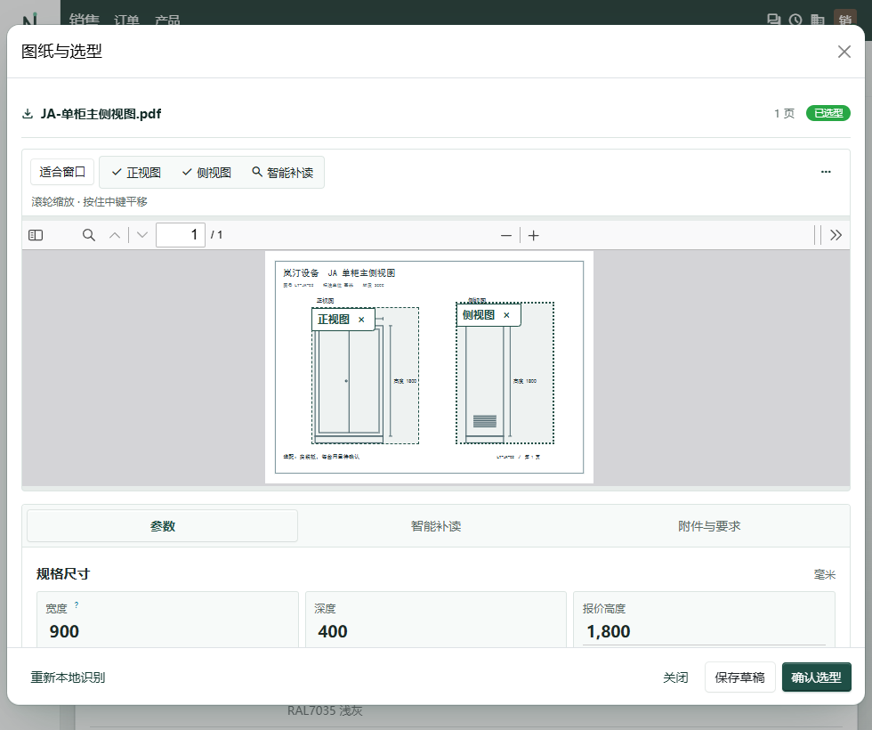
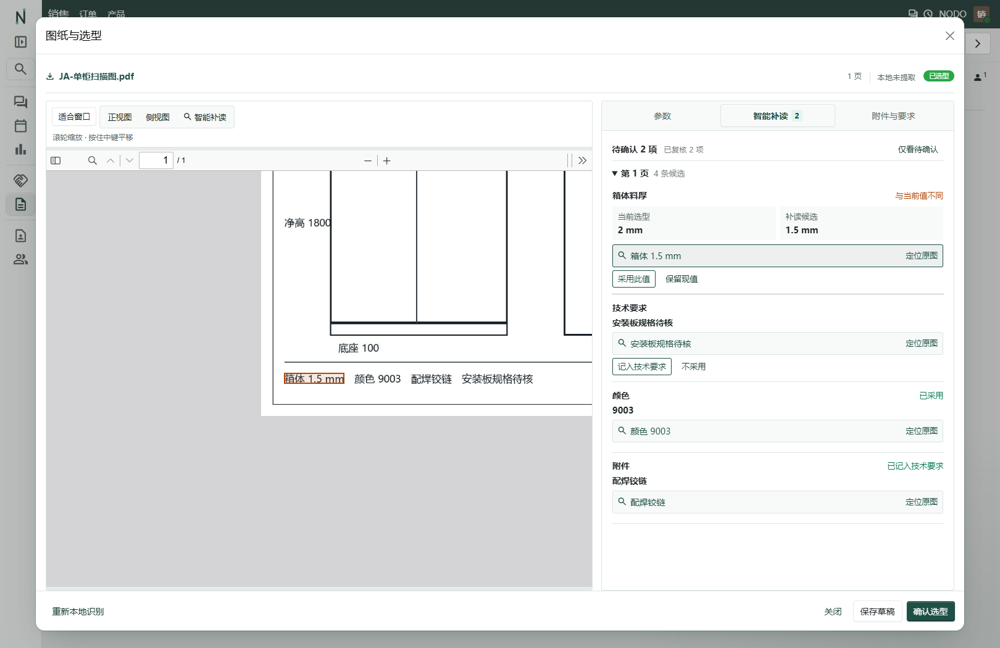

# 单柜报价与销售订单

适用 NODO 销售中的单柜报价。开发库已走查文字层 PDF 和选型保存。[单柜报价验收](../../验收/NODO单柜报价验收.md)

## 销售录单

1. 打开「销售」，在「订单 → 报价单」新建并选择客户和人民币价目表。填写付款条款和交付日期，确认对客文件采用含税或未税金额。
2. 有图纸时，点「图纸与选型 → 上传图纸」。可一次选择多份 PDF、图片、DWG 或 DXF。上传后点产品行的「查看与选型」。宽屏在左侧保留原图，右侧面板可独立滚动。窄窗口在图纸下方显示选型面板。文字层 PDF 可本地读取，扫描 PDF 可框选局部补读。整页扫描识别和 CAD 转换需原识图运行包。
3. 在阅图工具栏点「正视图」或「侧视图」，拖动框住相应视图和尺寸标注。需要改框时再点对应视图，另一框保留。可按 Esc 退出当前框选，点「适合窗口」恢复初始取景，或在更多工具中撤销、交换和清除选框。
4. 在「参数」核对宽度、深度、报价高度和尺寸来源，点击来源可定位到原图。总高、箱体净高和底座高分别保留，按本单口径选择报价高度。缺项可手工填写。往下核对柜型、台数、门型、材质、料厚和喷塑。
5. 切到「附件与要求」，根据匹配到的企业料号或附件名称文字核对图纸候选。候选由销售勾选，也可按名称或分类手工添加。选配区可填写每台用量、型号和实测尺寸，实测尺寸可填 `{"长度": 600}`。需要取消选配时，取消勾选该附件的「计入报价」。已核对的图纸备注记在「技术要求」。
6. 点「确认选型」，保存到当前报价的关联明细。需要稍后复核时点「保存草稿」。无图纸时可在同页「添加明细行」或「目录」选产品，直接填写尺寸和数量，再用该行的「配置」选配附件。
7. 选型齐全后点击「提交核算」。核算完成后，在「报价明细」检查金额，再由销售或核算提交批准。

### 智能补读 PDF 局部

1. 在阅图工具栏点「智能补读」，框入难读的尺寸、手写备注或工艺要求。对照选框后点击「识读选区」，将所选局部图像交给公司的识读服务。如需放弃这次框选，点击「退出框选」。
2. 在「智能补读」面板查看返回结果。页签上的数字表示待确认项数，可点「仅看待确认」逐项处理。与当前选型不同的候选会并列显示两组值。点击「定位原图」可回到对应区域。
3. 对照原图逐项采用或保留当前值。总高与箱体净高按本单口径选择「用作报价高度」。技术要求和非标附件原文可「记入技术要求」。在「附件与要求」按企业目录确认可计价附件并填写用量。
4. 确认完关键参数后点击「确认选型」。补读未完成或未配置时，可对照原图手工选型。

## 核算与批准

1. 核算在「报价与成本」核对材料、废料系数、折扣系数、成本运费及对客运费。材料单价与废料系数未填写或为零时，采用原规则默认值。修改后需要重新点击「计算报价」。
2. 核算成功后，打开版本查看原报价和成本明细。缺服务配置、规则目录、附件型号或尺寸时，系统显示失败原因。规格或附件须补录时，用「撤回到选型」交还销售。
3. 批准人在「待批准」核对选型、成本和对客金额，再点击「批准报价」。退回会保留历史核算版本，修改后须重新核算并批准。

## 发给客户与确认订单

1. 报价批准后，下载「客户 PDF」和「客户 Excel」。核对两个文件的版本、规格、台数和金额后，通过约定渠道发给客户，再点「登记已发出」。
2. 收到客户对该版本的接受凭据后，填写「客户确认凭据」并点击「登记客户确认」。当前单据进入「合同」阶段。
3. 批准人核对客户接受记录后点击「确认销售订单」。同一个编号转成销售订单，保留原批准版本。技术和物流交接单独办理。

附件名称建议在选型时生成。附件实际规格、金额和单柜价格在核算时由原计价服务匹配计算。
