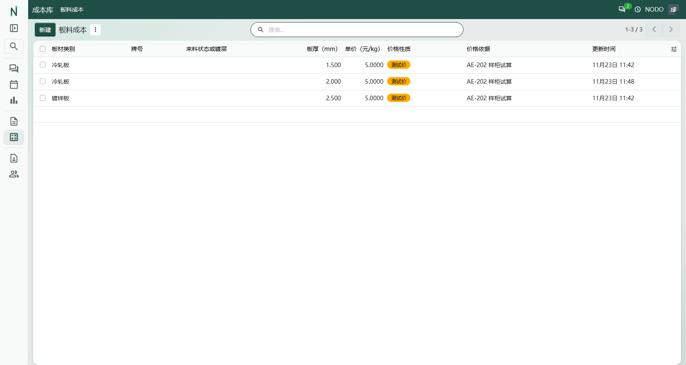

# 板料成本维护

适用本机 NODO 成本库，2026-11-23 核对。核算员和管理员维护单价，技术员查看并在模型上选用。

1. 打开侧栏「成本库 → 板料成本」。按板材类别、厚度、牌号或来料状态找到规格。每条价格以人民币元/kg 计。
2. 已有规格时打开原记录，更改「单价（元/kg）」并保存。新规格点「新建」，填入板材类别、板厚、单价和价格性质。已有依据的牌号、来料状态或镀层一并录入。「价格依据」可填写这条价格的来源。
3. 试算时选择「测试价」，企业实际采用的价格选择「业务价」。同一公司同一规格只允许一条启用价格。暂时停用的规格可归档，重新启用时必须满足同一限制。
4. 到技术工作台「材料」查看单价，或打开「AE-202 → 零件 → 板料用量」看逐件金额。板材类别、牌号、来料状态或镀层以及板厚均须匹配。留空的牌号或来料状态只匹配同样留空的规格。材料表面喷塑另行核算。

