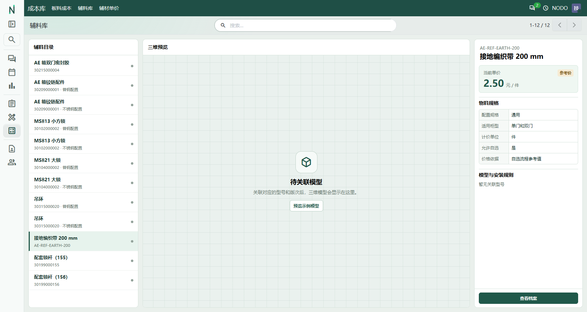
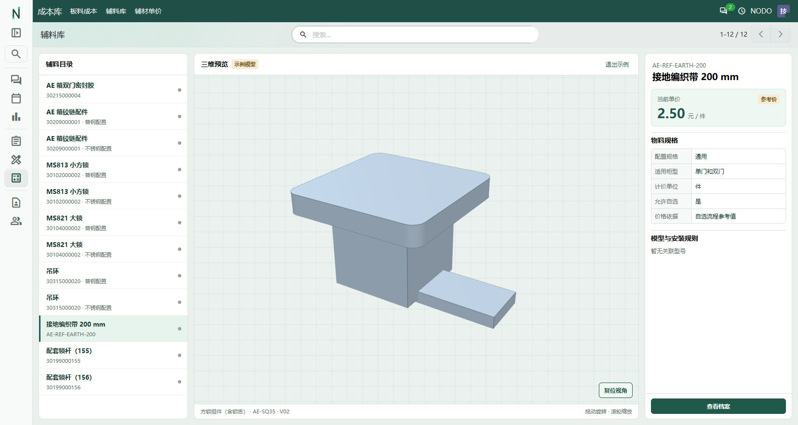
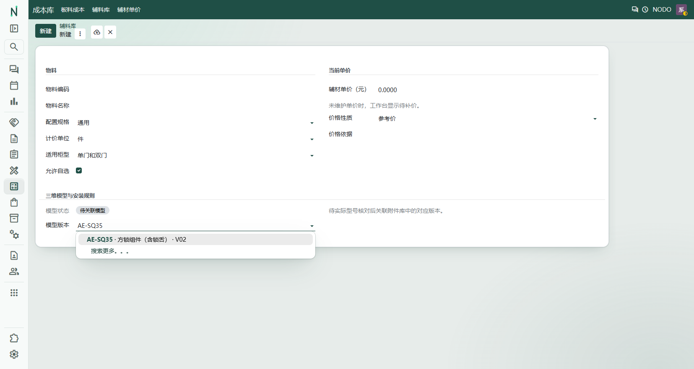

# 辅料档案与单价维护

1. 打开「成本库 → 辅料库」。按名称或编码搜索，可按适用柜型和模型状态筛选。点击左侧目录选中物料，中间查看三维，右侧核对当前单价、配置规格和安装规则。点右下角「编辑档案」维护，技术岗位可点「查看档案」。
2. 新建时填写采购编码、名称、配置规格和计价单位。适用柜型可以选择单门、双门或两种。允许技术加购的物料勾选「允许自选」。同一公司同一编码及规格维护一份档案。
3. 填写每件、每套或每米的单价，选择价格性质，并记录价格依据。保留空价或零价时，工作台会提示待补价。采购规格或单位变化时，为新规格登记独立编码，可归档旧档。
4. 保存后，在技术工作台打开该柜的「报价 → 辅材」确认价格和金额。可自选的档案在右侧选料抽屉显示当前单价。旧表里的 AE 箱铰链配件 `30209000001` 与焊接图里的铰链管 `30209000002` 分别维护采购依据。标配规则使用物料编码、配置规格和单位匹配。
5. 模型核对后，管理员在「三维模型与安装规则」选择同一公司附件库中的具体型号版本并保存。技术员和管理员可在中间视口拖动旋转、用滚轮缩放并点「复位视角」。缺少对应模型时显示「待关联模型」。点「预览示例模型」可体验三维操作，点「退出示例」或切换物料即可退出。

