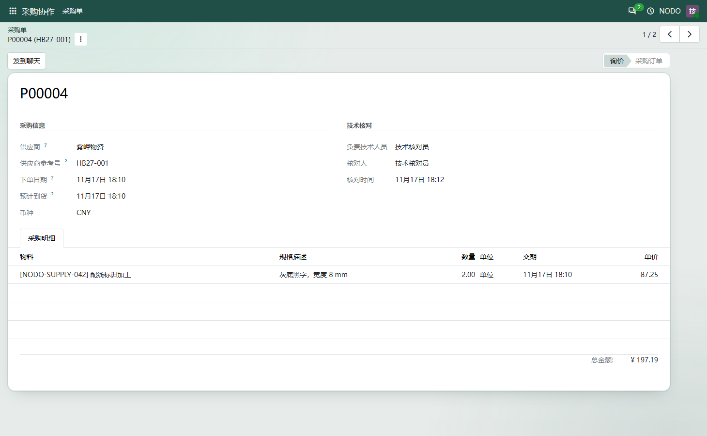

# 采购与技术协作

适用 NODO 当前试点版本。2026-11-17 用采购助理、采购和技术账号核对。入口为「主页菜单 → 采购协作 → 采购单」。

| 你是 | 现在可以做什么 | 交给谁 |
|---|---|---|
| 采购助理 | 录入和修改本人的草稿。只看本人录入且当前还是草稿的价格 | 把单号交给采购或采购经理 |
| 采购或采购经理 | 在授权公司内看采购单和价格、录改草稿、分派技术、确认下单 | 技术核对后，由其中一个采购岗位完成下单 |
| 负责技术人员 | 打开分派给自己的单据，核对规格、数量、交期及授权价格，记下核对结果 | 把核对结果交回采购 |

本手册说的「草稿」，在表单状态栏显示为「询价」。确认后显示为「采购订单」。

## 采购助理录入草稿

1. 在采购单列表点「新建」，从「供应商」下拉或「搜索更多」选已建档且适用于本公司的供应商。员工工作联系人不会出现在候选中。有实际供应商参考号时填写「供应商参考号」。
2. 在「采购明细」点「添加行」。从候选中选定物料，然后补全规格描述、数量、单位、交期和单价。
3. 填完最后一个单价后，用鼠标点表单标题或明细区外的位置。看到末尾多出一条空白编辑行时，先移除这条未保存的空行，再保存。
4. 点左上方云朵上箭头「手动保存」。确认出现单号，查看数量、单价和总金额是否正确。
5. 记下单号，交给采购或采购经理。草稿确认后会移出助理的草稿列表。

[供应商候选与空名单截图](../../验收/采购协作权限验收.md#供应商选择验收)

## 采购分派技术

1. 在列表搜索单号，打开草稿。采购或采购经理也可以自己新建和修改草稿。
2. 在右侧「技术核对」区找到「负责技术人员」，选择实际负责的人，然后点「手动保存」。
3. 把单号告知技术人员。分派成功后，技术可从采购单列表找到这张单。本轮实测单据没有自动生成技术待办。

## 技术人员核对规格

1. 在「采购协作 → 采购单」按单号找到分派给自己的单据。
2. 核对物料、规格描述、数量、单位和交期。按分配的权限查看该单单价和总金额。
3. 核对完点「确认规格已核对」。右侧应显示「核对人」和「核对时间」，然后通知采购查看结果。
4. 修改规格、物料、数量或交期会清除原核对结果。技术需要按修改后的内容重新核对。

## 采购确认下单

1. 采购经办或采购经理打开同一张单，查看规格、价格及右侧的核对人和时间。
2. 确认无误后点「确认采购单」。
3. 查看右上方状态已切到「采购订单」。再用采购助理刷新列表时，这张单应已离开助理的草稿范围。

[确认后的状态截图](../../验收/26-采购权限-05-采购确认.png)

## 常见问题

| 你看到的情况 | 怎么做 |
|---|---|
| 暂无供应商，或搜不到要下单的供应商 | 核对名称和单据公司。请有供应商维护权限的同事到「采购 → 订单 → 供应商」建档或核对启用状态，再回到采购单查找。 |
| 点保存弹出「哎呀！出错了」 | 如果上一动作是从单价栏按 Tab，关闭提示并看表格末尾。移除多出的未保存空白行，再点「手动保存」。 |
| 技术找不到这张单 | 请采购检查是否选对了「负责技术人员」并保存。核对两边的公司和单号，再刷新列表。 |
| 助理找不到刚才录入的单 | 先问采购该单是否已确认。助理可查本人当前草稿，确认后的进度由采购查看。 |
| 金额或确认按钮不见了 | 核对当前单据状态，刷新页面，再请管理员查看当前生效的个人权限。 |

练习时可用虚构供应商「雾岬物资」、物料「配线标识加工」，由各岗位接力走完一张单。采购经理可以另用一张草稿验证独立确认。[匿名验收账号和原专项截图](../../验收/采购协作权限验收.md)
