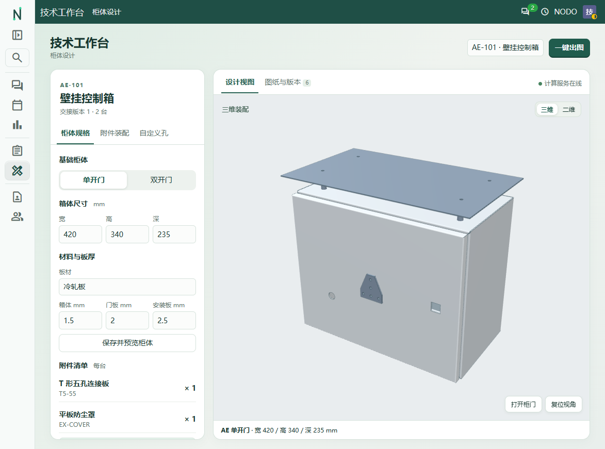
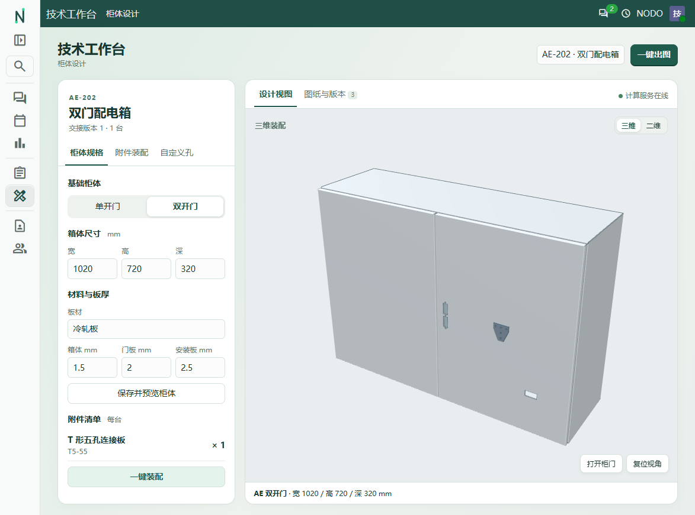
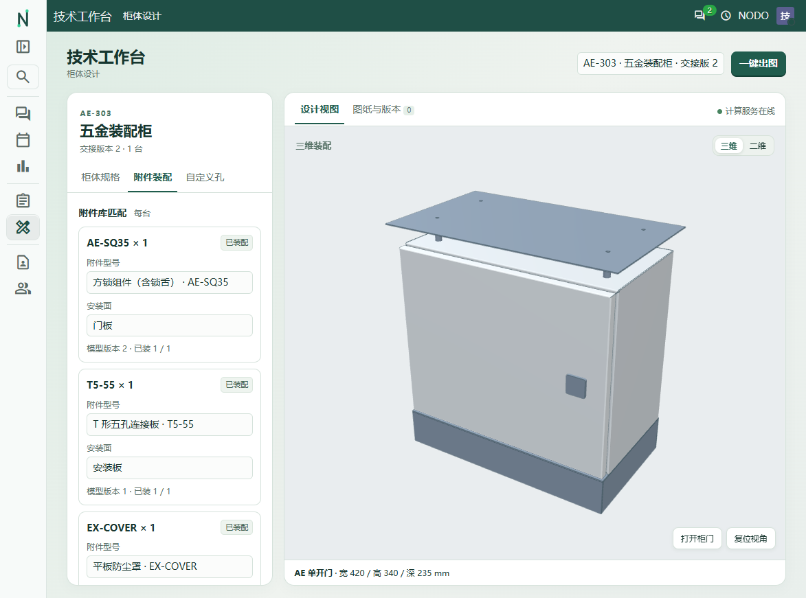
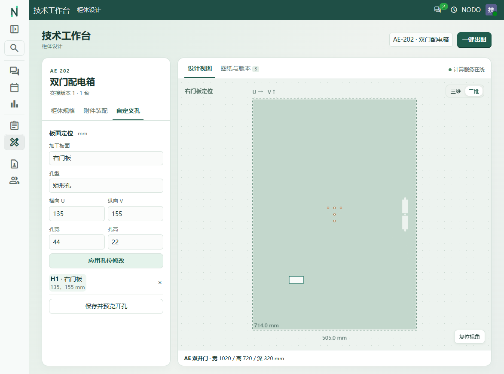

# 柜体设计与出图

适用本机 NODO 开发库的技术岗位。核对日期为 2026-11-19。

1. 在左侧「业务 → 技术工作台」打开「柜体设计」，用右上角选择器选一条已交接的清单。左栏显示清单来源、版本和台数。附件数量按一台柜计算。
2. 在「柜体规格」选择 AE 单开门或双开门，分别填写宽、高、深（mm）。确认板材以及箱体、门板、安装板的板厚。「保存并预览柜体」会计算当前模型。
3. 点「一键装配」后，在「附件装配」核对每行的型号、安装面和已装数量。未识别的型号须人工对应附件库。顶罩按柜顶和伸出量放置，T 形连接板使用固定的 STEP，在选择的板面上按安装基准定位。可调附件的横向、纵向和转角以该附件下方标明的板面基准为准。改完再点「一键装配」。
4. 三维视图用鼠标拖动旋转、滚轮缩放。点「打开柜门」可看内部装配，点「复位视角」可按当前开合状态完整显示柜体。点中可加工板面时，二维编辑器自动显示该板面，并填入点击处的 U、V 毫米坐标。右门 U 从右侧铰链向中缝增加，V 从下边向上。也可在「自定义孔」内手动选板面。点在五金上会留在三维视图。
5. 选择圆孔、矩形孔或长圆孔，填孔中心 U/V 和孔尺寸后点「添加孔位」。选已有孔号可修改或移除。点「保存并预览开孔」可先核对三维结果。页面会提示未保存修改或当前显示的是上一版模型。
6. 点「一键出图」，在「图纸与版本」查看该次计算。计算成功后可下载整套图包、整柜 STEP、零件清单或孔位表，也可按图下载 DWG 和对应的切割 DXF。失败的尝试保留原因，成功版可以重复下载。版本下的「工程依据与待核项目」记录工艺条件。

### 查看五金装配

在右上角选择「AE-303 · 五金装配柜」交接版 2。点「附件装配」可核对方锁、安装板五孔连接板、顶罩和底座。方锁以板面右边为横向基准，距右边 52.5 mm，纵向位于门板中心。样例复用了门板原有的 21.2 mm 方孔。方锁对应闭锁位置的装配包络，采购型号、制造公差和锁舌行程待供应商确认。

### 双门柜开孔与展开图

AE-202 的右门上有一个 44 × 22 mm 的矩形孔。门板基准下孔中心为 U135、V155 mm，对应门板展开件中的 X147.82、Y166.60 mm。请按孔位表区分两个坐标系。独立切割 DXF 只含加工轮廓，打印和尺寸标注可在配套 DWG 查看。

### 工程状态

两个样例使用参考图和参考附件。原图未覆盖的门板展开补偿、折弯扣除、部分材料、密封及承载仍须工艺人员确认。「已生成」表示文件生成通过，车间放行需要单独的工艺复核。
