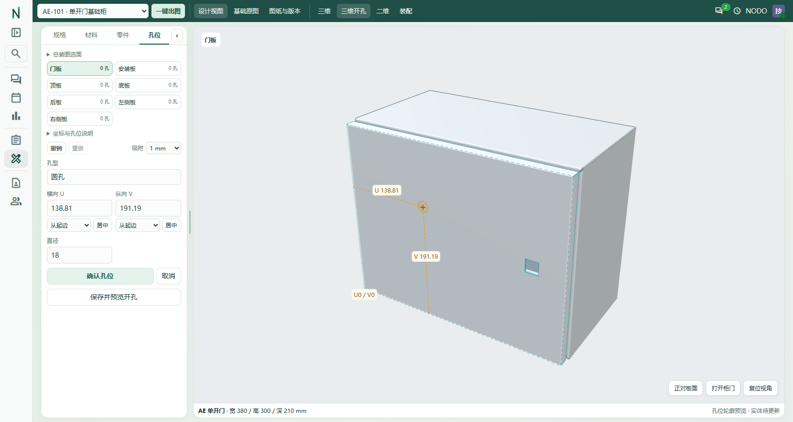
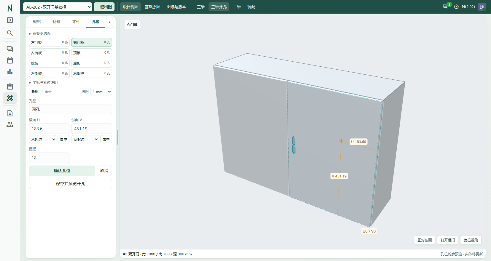
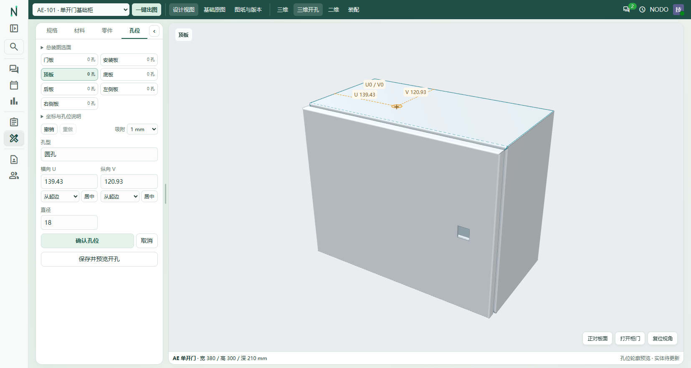
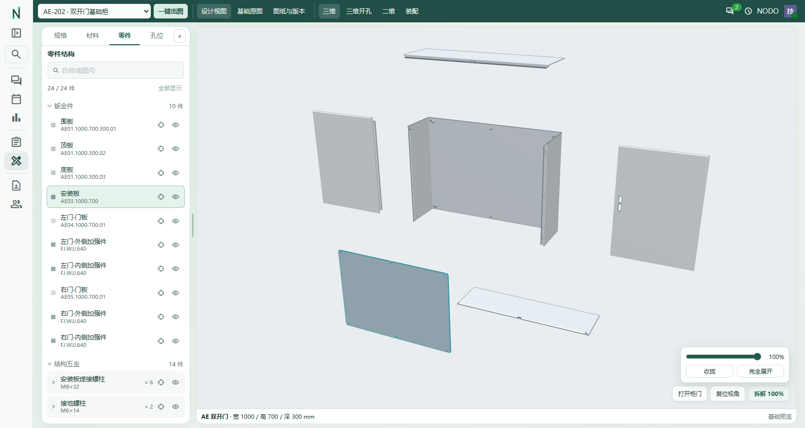
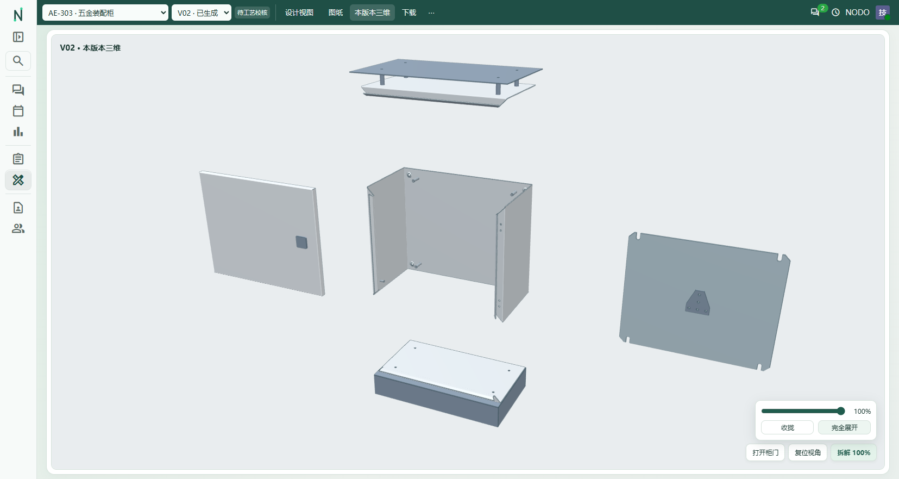
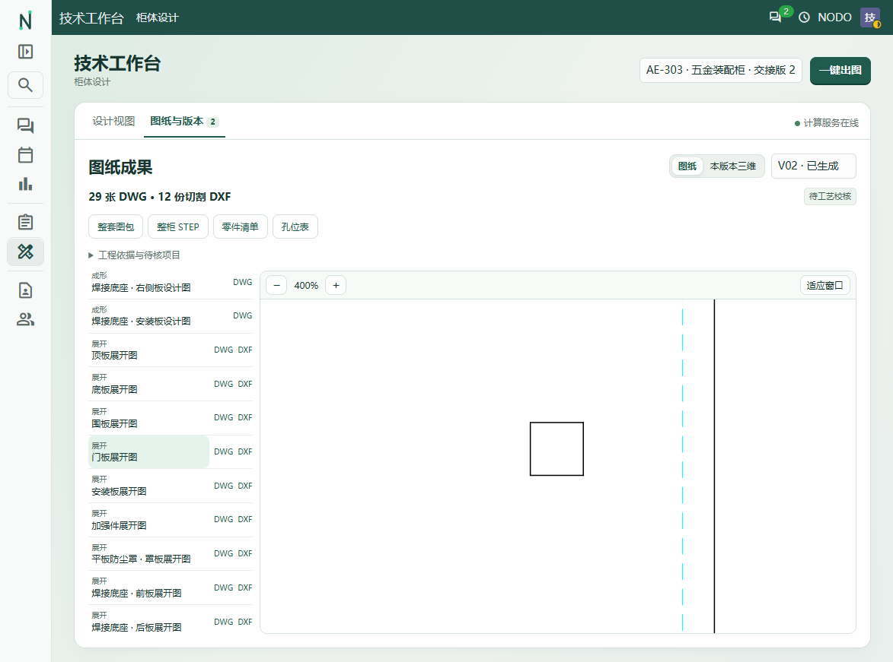
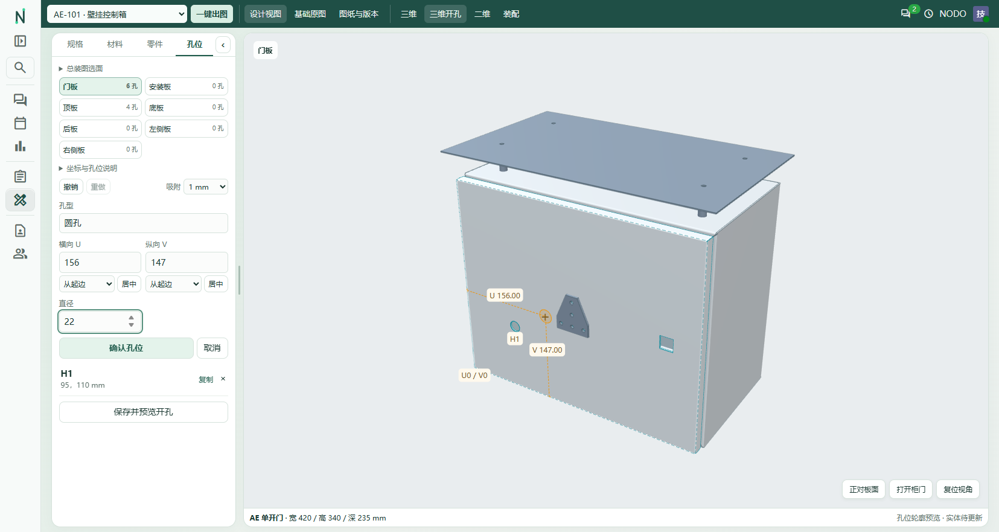
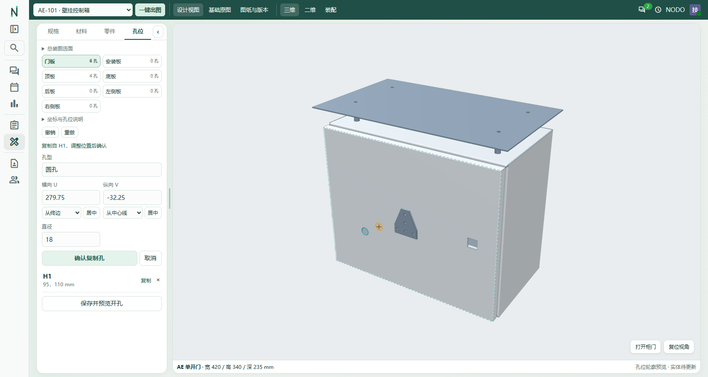
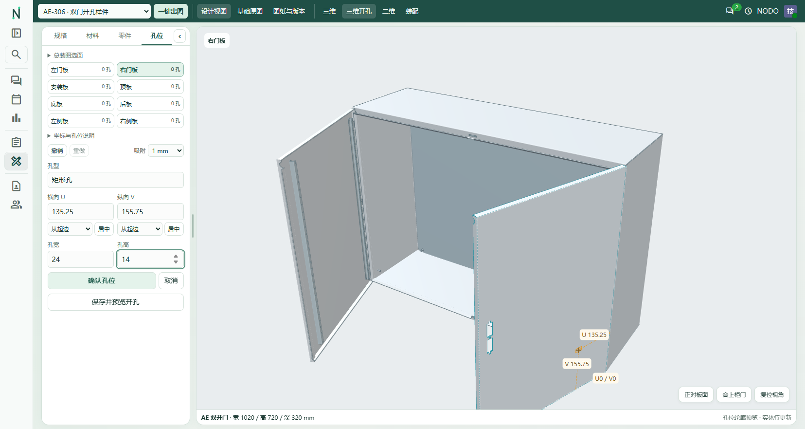
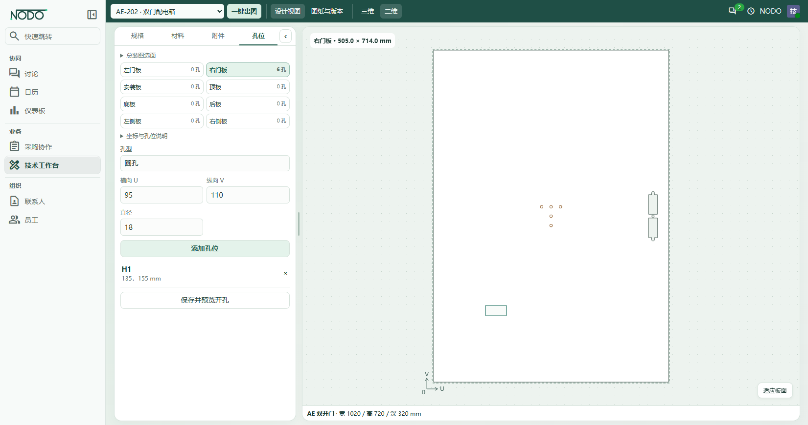

# 柜体设计与出图

适用本机 NODO 开发库的技术岗位。默认设计为 AE-101 单开门基础柜（380 × 300 × 210 mm）和 AE-202 双开门基础柜（1000 × 700 × 300 mm），尺寸顺序为宽、高、深。核对日期为 2026-11-20。

1. 在左侧「业务 → 技术工作台」进入设计页。用深绿色顶栏左侧的选择器换柜体，鼠标停在选择器上可查看交接版和台数。「规格」「材料」「零件」「孔位」共用左侧设计栏。可拖动分隔线调整宽度，或点「收起设计栏」给模型留出更多空间。
2. 在「规格」选择 AE 单开门或双开门。右侧按当前宽、高、深及材料板厚显示基础柜体。可以旋转模型、打开柜门，视口下方显示实际预览尺寸。确认规格后点「保存并预览柜体」写入设计。
3. 在「材料」按箱体、门板、安装板分组设置板材与板厚。点「按零件」可分别设置围板、顶板、底板、门板、安装板和左右加强件。双门共用门板材料和厚度设置。每行的「⋯」可填牌号、来料状态或镀层、表面处理和材料依据。「恢复跟随」将该零件的材料和板厚恢复到所属分组或原图默认值。点「应用材料并预览」后核对模型。
4. 在「零件」查看基础柜的钣金件和结构五金，可以按名称或图号搜索。点零件名称联动高亮，点十字准星定位，点眼睛切换显示，点「全部显示」恢复。相同规格的螺柱可以展开逐件查看。在这个页签里点击三维模型也可选中对应零件。点视口右下角「拆解」，可拖动 0% 到 100% 的滑杆，或点「完全展开」「收拢」。松开滑杆或点按钮后，视角会自动适配可见零件。双门柜完全展开时，两扇门在围板两侧，安装板在左下，顶板、底板上下分开。拆解时仍可旋转、缩放、开关柜门和点选零件。需要重新看全时点「复位视角」。
5. 对已收到附件清单的设计，点顶栏「装配」查看装配模型，在右侧确认各行的型号、安装面和每台用量。点「一键装配」后核对已装数量。未识别的型号须人工对应附件库。顶罩按柜顶和伸出量放置，T 形连接板使用固定的 STEP，在选择的板面上按安装基准定位。可调附件的横向、纵向和转角以该附件下方标明的板面基准为准。改完再点「一键装配」。空附件清单显示「此柜体尚无附件」。
6. 在顶栏点「三维开孔」，直接点击模型上的板面放置孔中心。从「规格」进入时仍使用无附件柜体，从「装配」进入时沿用当前装配模型。从拆解状态进入时，模型自动收拢并带入选中的可加工板面。切回「三维」时恢复刚才的拆解比例。画布显示孔轮廓和 U/V 基准线，可拖动中心或在左侧输入坐标。选圆孔、矩形孔或长圆孔并输入尺寸。拖动时可按 1 mm 或 0.1 mm 吸附，也可关闭吸附。「正对板面」单独对准当前板件，「返回整柜」恢复上一个整柜视角。
7. 点「确认孔位」写入草稿，然后可在同一板面继续落孔。直接点模型上另一块可见的加工板面，左侧同步切换。各面的待确认孔位分别保留，点回时恢复原位置和尺寸。点已有自定义孔可修改。原图开孔和附件孔可以查看，原图孔位由基础柜定义，附件孔位在「装配」调整。点「保存并预览开孔」计算实体。有待确认的孔位时，先确认或取消再保存及出图。
8. 点顶栏「基础原图」查看当前柜型对应的原图。从版本下拉可切换单门原图、双门原图和已有批次。原图尺寸按宽 × 高 × 深标在顶栏。用「目录」选择原图，用「下载」取当前原始 DWG。查看原图时保留设计草稿中的规格。
9. 点「一键出图」时，标准参数打开对应基础原图，已有相同参数的出图批次直接复用。尺寸、材厚、附件或孔位发生变化且需要新的成果时，生成新的图纸版本。「下载」提供当前 DWG、切割 DXF、图包、STEP、零件清单和孔位表。图纸支持滚轮缩放、拖动平移和「适应窗口」，工艺待核事项在「⋯」里查看。
10. 在出图批次点「本版本三维」查看同一批次的归档模型，可以旋转、缩放、开关柜门和拆解。装配五金随安装板件移动。每次打开归档模型时从收拢状态开始。切回「图纸」会恢复刚才的图纸和视角。进入「设计视图」可继续原有草稿。失败的出图版本显示该批次的原因。

### 查看五金装配

以下装配图取自历史验收样例。AE-303 交接版 2 用于核对方锁、安装板五孔连接板、顶罩和底座。方锁以板面右边为横向基准，距右边 52.5 mm，纵向位于门板中心。样例复用了门板原有的 21.2 mm 方孔。方锁对应闭锁位置的装配包络，采购型号、制造公差和锁舌行程待供应商确认。

出图 V02 的「门板展开图」可以放大查看右侧方孔。「零件明细表 1/2」和「2/2」列出方锁、连接板、防尘罩和底座的组成件。两页明细和开门三维见[历史阅图与同版三维验收](../../验收/52-图纸阅图与同版三维.md)。

### 双门柜开孔与展开图

普通「三维」可旋转、缩放、开关柜门，也可在「零件」页签点选零件。用顶栏「二维」主动切换到二维，三维与二维共用孔位草稿和撤销记录。可在「孔位」直接选择板面，或在二维展开「总装图选面」按朝向定位。单门有 7 个可加工板面，双门有 8 个。

在「孔位」的 U 和 V 下方可分别选「从起边」「从终边」或「从中心线」。切换基准时原孔位置保持不动，孔位清单仍显示从板面 U/V 原点量取的坐标。每个轴旁的「居中」只调整当前轴。右门的 U 起边在铰链侧，U 终边在中缝侧。

在自定义孔的这一行点「复制」，保留原孔的板面、孔型和尺寸。从同一位置开始调整，位置、孔型和尺寸相同的孔会提示冲突。点「确认复制孔」后生成新的孔号。可以用「撤销」「重做」恢复孔位输入、居中、添加、修改和移除。历史保存在当前编辑会话，保存设计或切换柜体后重新开始记录。

历史 AE-202 出图样例在右门上加工了一个 44 × 22 mm 的矩形孔。门板基准下孔中心为 U135、V155 mm，对应门板展开件中的 X147.82、Y166.60 mm。请按孔位表区分两个坐标系。独立切割 DXF 只含加工轮廓，打印和尺寸标注可在配套 DWG 查看。

### 工程状态

两个样例使用参考图和参考附件。原图未覆盖的门板展开补偿、折弯扣除、部分材料、密封及承载仍须工艺人员确认。「已生成」表示文件生成通过，车间放行需要单独的工艺复核。
