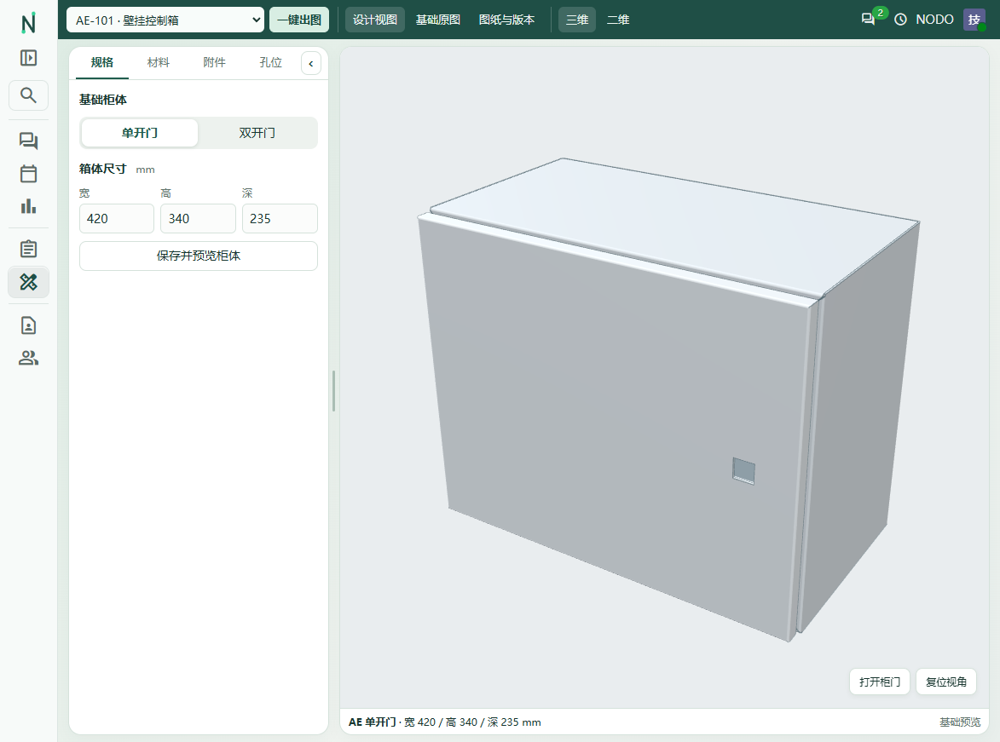
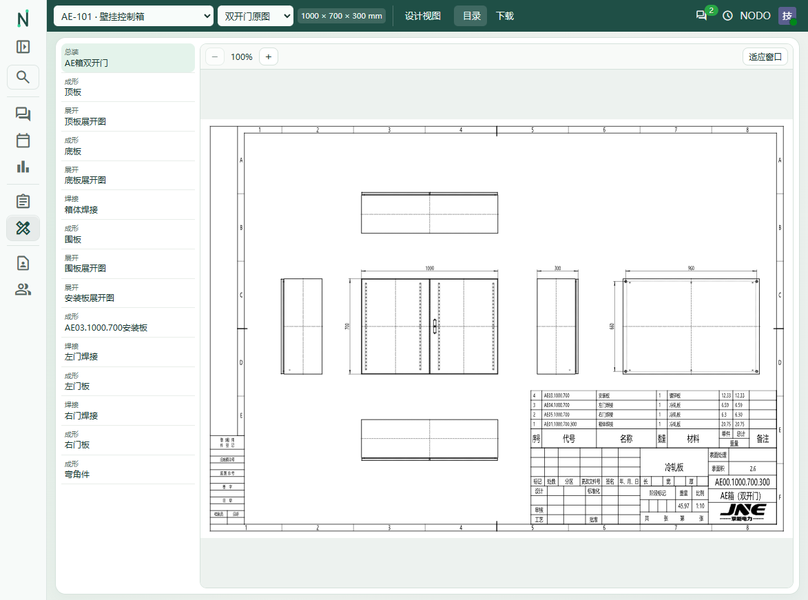
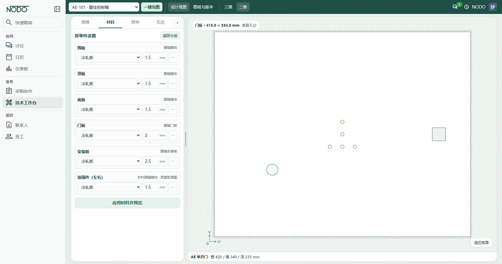
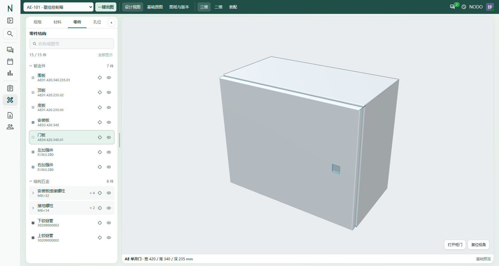
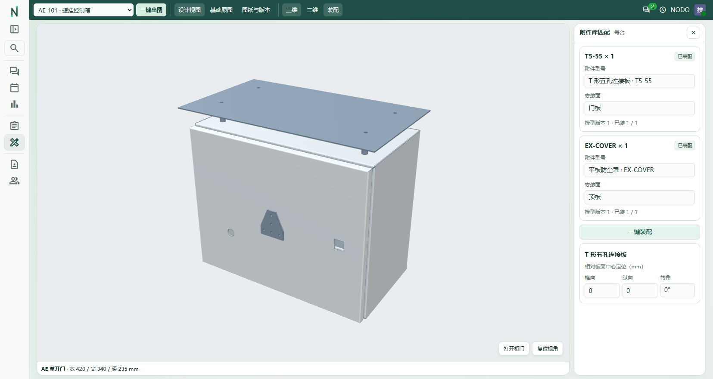
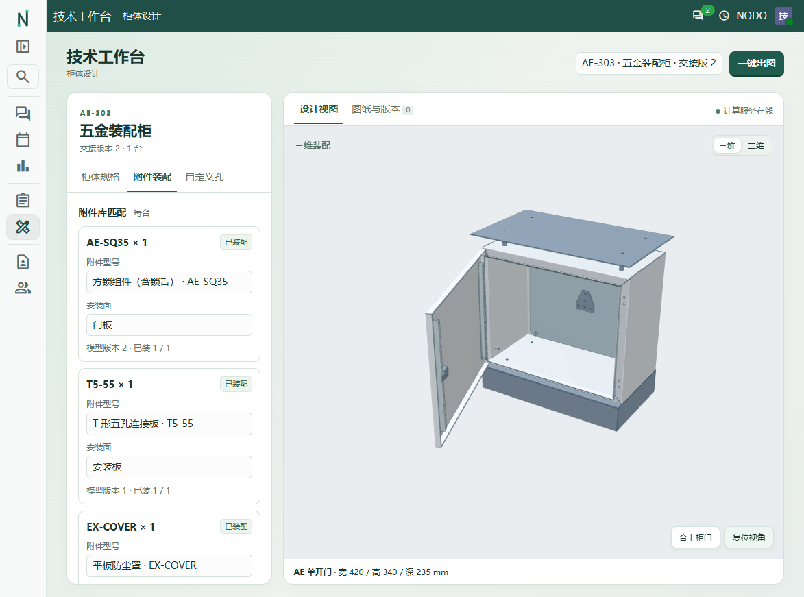
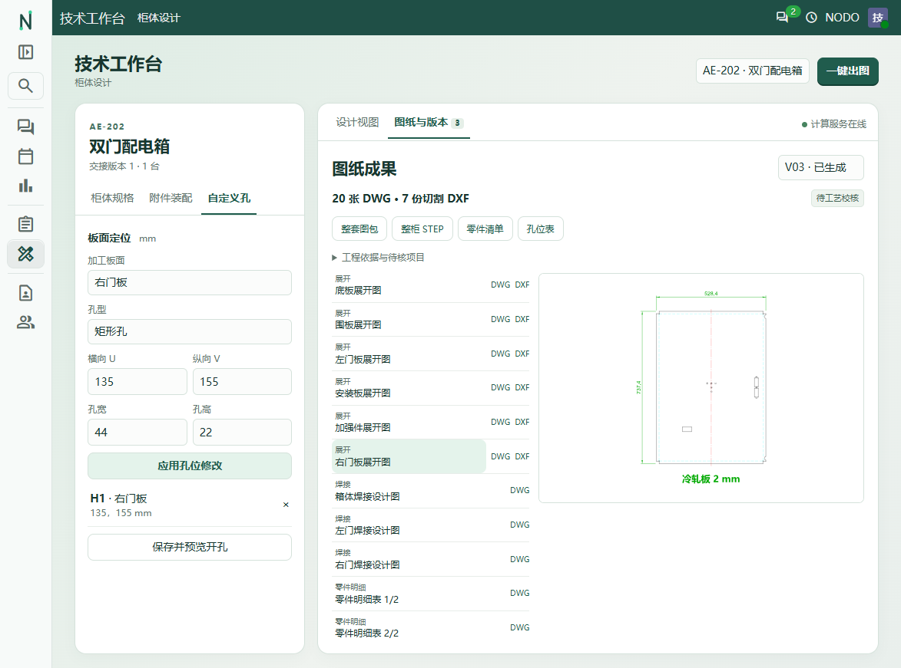

# 柜体设计与出图

适用本机 NODO 开发库的技术岗位。核对日期为 2026-11-20。

1. 在左侧「业务 → 技术工作台」进入设计页。用深绿色顶栏左侧的选择器换柜体，鼠标停在选择器上可查看交接版和台数。「规格」「材料」「零件」「孔位」共用左侧设计栏。可拖动分隔线调整宽度，或点「收起设计栏」给模型留出更多空间。
2. 在「规格」选择 AE 单开门或双开门。右侧按当前宽、高、深及材料板厚显示基础柜体。可以旋转模型、打开柜门，视口下方显示实际预览尺寸。确认规格后点「保存并预览柜体」写入设计。
3. 在「材料」按箱体、门板、安装板分组设置板材与板厚。点「按零件」可分别设置围板、顶板、底板、门板、安装板和左右加强件。双门共用门板材料和厚度设置。每行的「⋯」可填牌号、来料状态或镀层、表面处理和材料依据。「恢复跟随」将该零件的材料和板厚恢复到所属分组或原图默认值。点「应用材料并预览」后核对模型。
4. 在「零件」查看基础柜的钣金件和结构五金，可以按名称或图号搜索。点零件名称联动高亮，点十字准星定位，点眼睛切换显示，点「全部显示」恢复。相同规格的螺柱可以展开逐件查看。在这个页签里点击三维模型也可选中对应零件。柜内零件可配合「打开柜门」查看。
5. 点顶栏「装配」，在右侧确认各行的型号、安装面和每台用量，点「一键装配」后核对已装数量。未识别的型号须人工对应附件库。顶罩按柜顶和伸出量放置，T 形连接板使用固定的 STEP，在选择的板面上按安装基准定位。可调附件的横向、纵向和转角以该附件下方标明的板面基准为准。改完再点「一键装配」。
6. 用顶栏的「三维」或「二维」切换视口。三维支持拖动旋转、滚轮缩放和开关柜门。从「规格」等编辑页签点中可加工板面时，二维编辑器自动切换到该板面，并填入点击处的 U、V 毫米坐标。也可在「孔位」中直接选择板面，或展开「总装图选面」按朝向定位。单门有 7 个可加工板面，双门有 8 个。右门 U 从右侧铰链向中缝增加，V 从下边向上。孔数包含自定义孔和附件孔，原图结构孔随轮廓显示。
7. 选择圆孔、矩形孔或长圆孔，填孔中心 U/V 和孔尺寸后点「添加孔位」。选已有孔号可修改或移除。切换板面会保留各自的孔位输入。点「保存并预览开孔」核对三维结果。页面会提示未保存修改，或当前显示的是上一版模型。
8. 点顶栏「基础原图」查看当前柜型对应的原图。从版本下拉可切换单门原图、双门原图和已有批次。原图尺寸按宽 × 高 × 深标在顶栏。用「目录」选择原图，用「下载」取当前原始 DWG。查看原图时保留设计草稿中的规格。
9. 点「一键出图」时，标准参数打开对应基础原图，已有相同参数的出图批次直接复用。尺寸、材厚、附件或孔位发生变化且需要新的成果时，生成新的图纸版本。「下载」提供当前 DWG、切割 DXF、图包、STEP、零件清单和孔位表。图纸支持滚轮缩放、拖动平移和「适应窗口」，工艺待核事项在「⋯」里查看。
10. 在出图批次点「本版本三维」查看同一批次的归档模型，可以旋转、缩放和开关柜门。切回「图纸」会恢复刚才的图纸和视角。进入「设计视图」可继续原有草稿。失败的出图版本显示该批次的原因。

### 查看五金装配

在顶部选择「AE-303 · 五金装配柜 · 交接版 2」，点「装配」打开右侧附件工作区，可核对方锁、安装板五孔连接板、顶罩和底座。方锁以板面右边为横向基准，距右边 52.5 mm，纵向位于门板中心。样例复用了门板原有的 21.2 mm 方孔。方锁对应闭锁位置的装配包络，采购型号、制造公差和锁舌行程待供应商确认。

出图 V02 的「门板展开图」可以放大查看右侧方孔。「零件明细表 1/2」和「2/2」列出方锁、连接板、防尘罩和底座的组成件。两页明细和开门三维见[历史阅图与同版三维验收](../../验收/52-图纸阅图与同版三维.md)。

### 双门柜开孔与展开图

AE-202 的右门上有一个 44 × 22 mm 的矩形孔。门板基准下孔中心为 U135、V155 mm，对应门板展开件中的 X147.82、Y166.60 mm。请按孔位表区分两个坐标系。独立切割 DXF 只含加工轮廓，打印和尺寸标注可在配套 DWG 查看。

### 工程状态

两个样例使用参考图和参考附件。原图未覆盖的门板展开补偿、折弯扣除、部分材料、密封及承载仍须工艺人员确认。「已生成」表示文件生成通过，车间放行需要单独的工艺复核。
