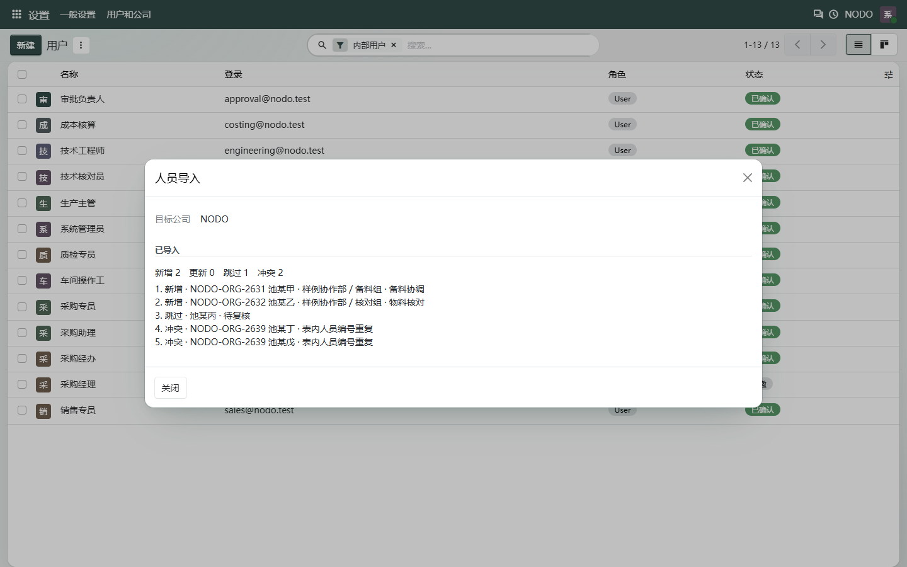

# 人员档案接入

适用 `nodo_staff_import`，2026-11-17 用虚构名单核对。系统管理员负责预检、导入和核对批次。真实名单在已确认的独立试点库中分批处理。

## 核对人员确认表

确认表支持 `.xlsx` 或 UTF-8 CSV。Excel 把人员资料放在第一张工作表，首行保留字段名称。每名人员填写一行。

| 字段 | 填写方法 |
|---|---|
| 人员编号 | 填公司确认的工号或稳定人员编号。Excel 中用文本保存。再次导入沿用原编号，防止同一员工建两份档案。 |
| 姓名 | 核对员工姓名。同名员工分别填写自己的编号。 |
| 部门路径 | 按从上级到下级填写，用带空格的 ` / ` 分隔各级，例如 `协作部 / 核对组`。 |
| 岗位 | 填写该员工现任岗位。与该部门的已有岗位同名时，系统会复用。 |
| 复核 | 核实编号、姓名、部门及岗位后填「通过」。其余保留「待复核」，系统会跳过。 |
| 已有登录名 | 只有确认需要关联现有账号时才填。账号须在目标公司可用，且为启用的内部账号。 |

表中的「拟授权岗位」「开通账号」供审批参考。员工导入维护档案及已明确的账号关联，岗位权限和个人开关由管理员在用户档案中配置。真实确认表在获授权的位置本地保存，培训截图和开发库使用虚构名单。

## 预检和导入

1. 进入「设置 → 用户和公司 → 人员导入」，选择目标公司，上传人员确认表，点「预检」。
2. 核对汇总和逐行结果。新增和更新会显示目标部门及岗位。已有相同档案或待复核的行会跳过。编号重复、已有同名未编号档案、归档档案和账号冲突会提示原因。
3. 已有同名未编号档案时，先在「员工」应用打开对应档案的「工作」页，核实身份后补上「人员编号」，再回到导入窗口重新预检。其他冲突按页面原因核对后重新上传。
4. 点「导入档案」，系统处理预检里的新增和更新。若确认表或目标公司的相关档案已经变化，按提示重新预检。
5. 到「员工」应用的档案「工作」页核对人员编号、部门和岗位。到「设置 → 用户和公司 → 人员导入记录」核对本批文件名、导入人和各项数量。

重新上传同一份确认表时，信息一致的行显示为「跳过」。后续调岗或变更部门时用相同编号提交新资料。人员从确认表里移除时，原档案继续保留，由管理员在「员工」应用核实并处理离职。

## 开通账号和授权

导入后可以先核对人员档案。已填「已有登录名」的档案关联原账号，原权限继续生效。需要登录的新员工由管理员单独开通。根据确认后的职责给个人分配权限，采购助理、采购、采购经理和负责技术人员的设置见 [采购权限配置](采购权限配置.md)。
