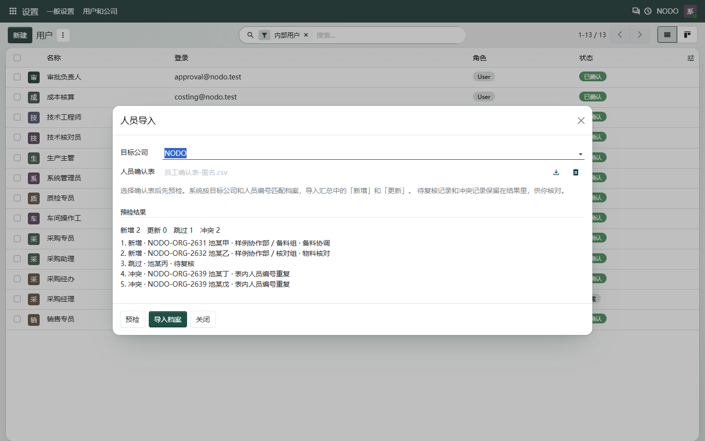
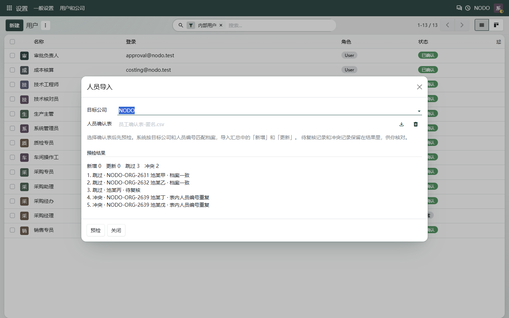
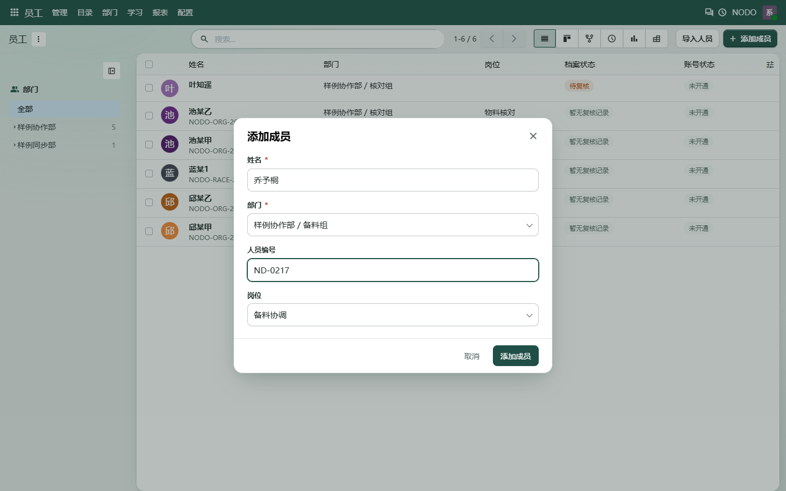
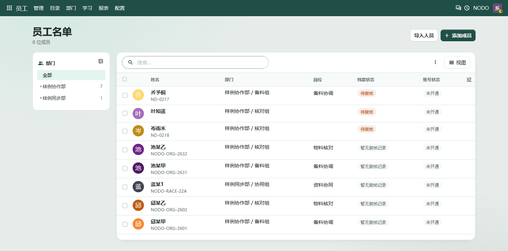
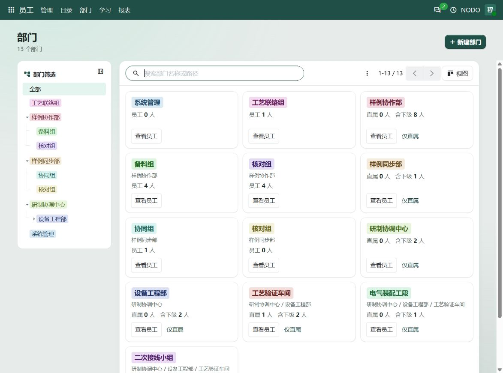
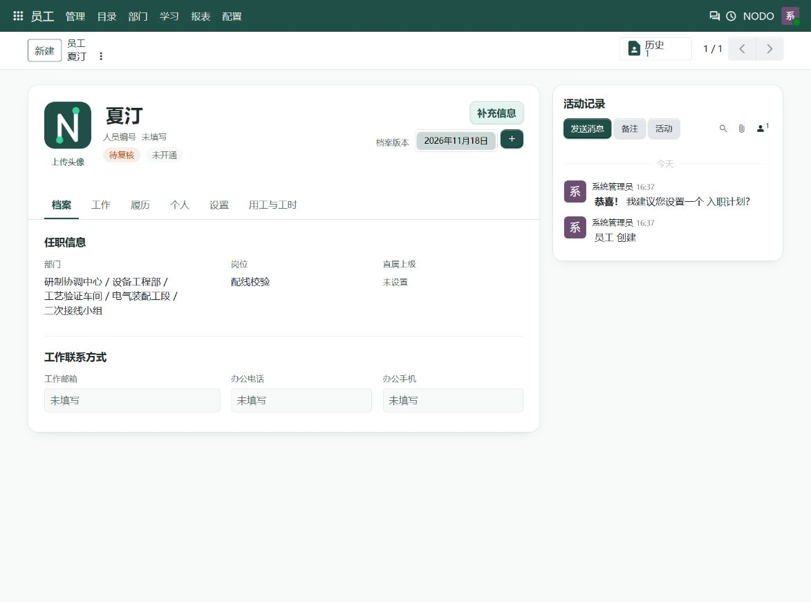
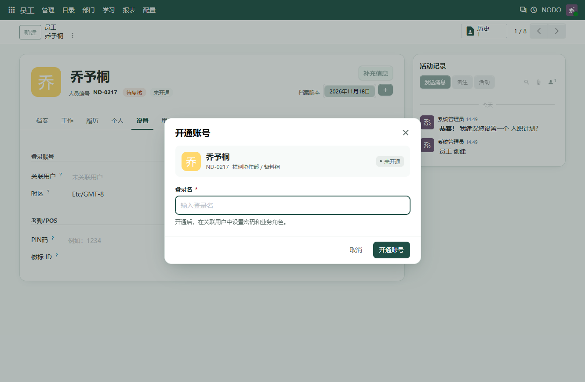
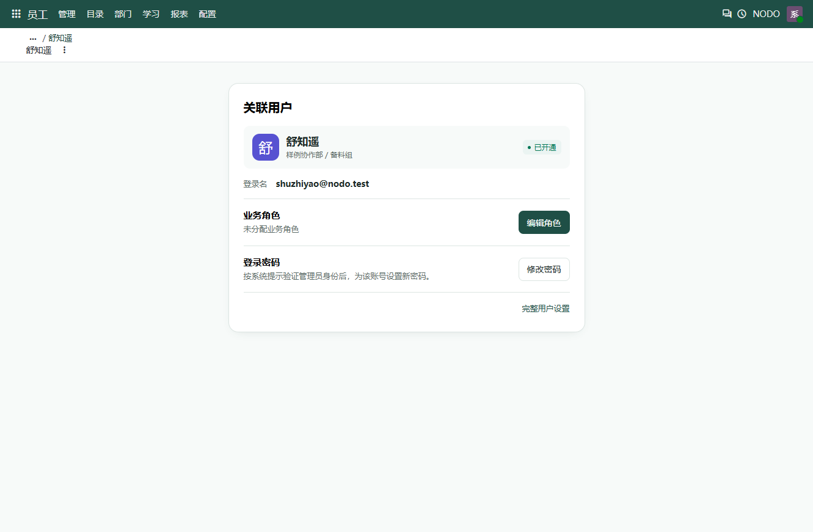
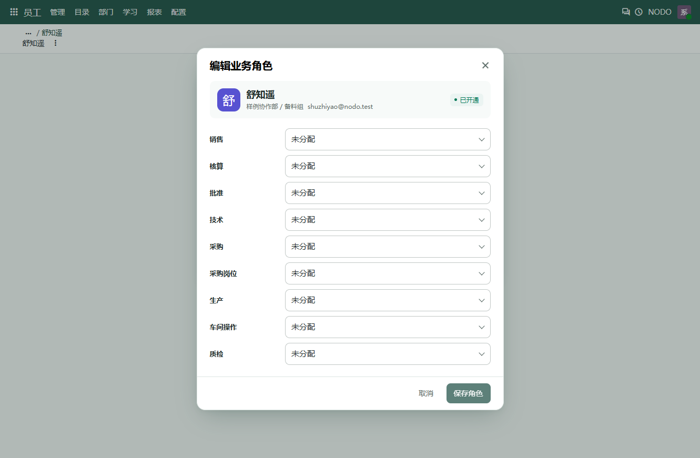
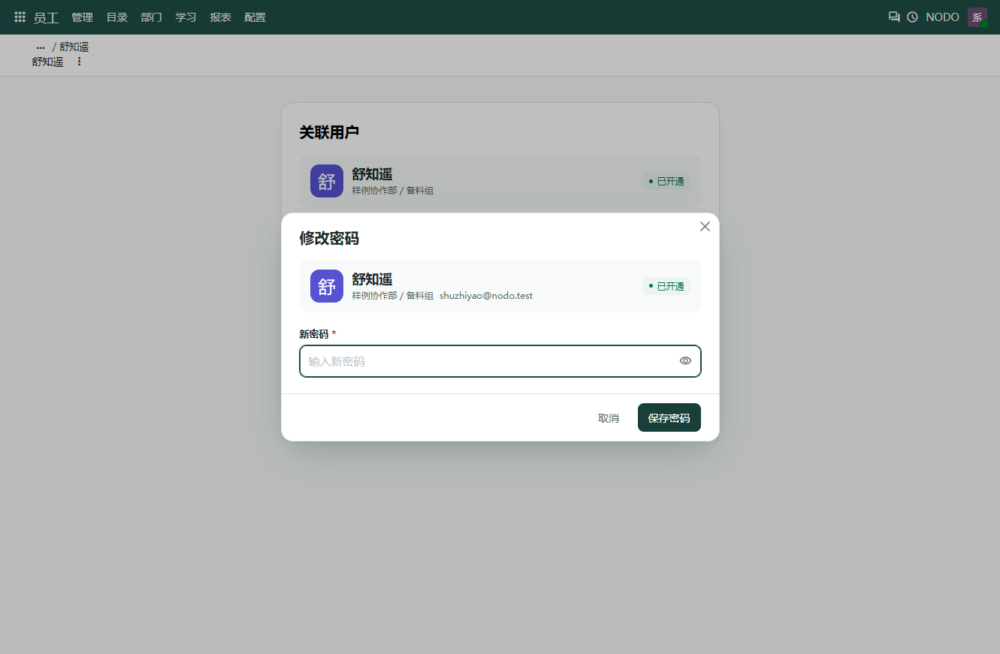

# 人员档案接入

适用 `nodo_staff_import`，2026-11-17 用虚构名单核对。系统管理员负责预检、导入和核对批次。真实名单在已确认的独立试点库中分批处理。

## 从架构图初始化试点名单

`nodo_staff_pilot` 是独立的人员试点库。通过本机 8079 登录时用 `?db=nodo_staff_pilot` 选择数据库，管理员凭据保存在被 Git 忽略的本地账号文件。进入「员工 → 管理」查看已导入的名单、部门树和员工详情。

在已授权的试点，可用 `scripts/nodo.ps1` 运行 `init-staff-pilot` 创建库。随后运行 `preview-staff-pilot <架构图路径>` 预检和 `import-staff-pilot <架构图路径>` 入档。预检完成后整批回滚。导入保留图中部门层级、原岗位和待复核标签。源岗位缺失的档案保留空值，来源编号记录在「工作」页的备注里，正式人员编号由管理员补齐。

同一份架构图重跑会核对已导入的档案。后续修改使用已核对的人员档案或人员确认表。名单、复核和账号权限入口见 [人员与部门界面方案](../../人员与部门界面方案.md)。

试点库已有人事资料时，运行 `scripts/nodo.ps1 check-staff-pilot` 核对来源批次和档案摘要。需要同步员工模块界面时运行 `scripts/nodo.ps1 update-staff-pilot`，完成后再运行同一检查。两次检查的档案指纹应一致。检查结果以汇总输出。

## 核对人员确认表

确认表支持 `.xlsx` 或 UTF-8 CSV。Excel 把人员资料放在第一张工作表，首行保留字段名称。每名人员填写一行。

| 字段 | 填写方法 |
|---|---|
| 人员编号 | 填公司确认的工号或稳定人员编号。Excel 中用文本保存。再次导入沿用原编号，防止同一员工建两份档案。 |
| 姓名 | 核对员工姓名。同名员工分别填写自己的编号。 |
| 部门路径 | 按从上级到下级填写，用带空格的 ` / ` 分隔各级，例如 `协作部 / 核对组`。 |
| 岗位 | 填写该员工现任岗位。与该部门的已有岗位同名时，系统会复用。 |
| 复核 | 核实编号、姓名、部门及岗位后填「通过」。其余保留「待复核」，系统会跳过。 |
| 已有登录名 | 只有确认需要关联现有账号时才填。账号须在目标公司可用，且为启用的内部账号。 |

表中的「拟授权岗位」「开通账号」供审批参考。员工导入维护档案及已明确的账号关联，岗位权限和个人开关由管理员在用户档案中配置。真实确认表在获授权的位置本地保存，培训截图和开发库使用虚构名单。

## 预检和导入

1. 进入「设置 → 用户和公司 → 人员导入」，选择目标公司，上传人员确认表，点「预检」。
2. 核对汇总和逐行结果。新增和更新会显示目标部门及岗位。已有相同档案或待复核的行会跳过。编号重复、已有同名未编号档案、归档档案和账号冲突会提示原因。
3. 已有同名未编号档案时，先在「员工」应用打开对应档案的「工作」页，核实身份后补上「人员编号」，再回到导入窗口重新预检。其他冲突按页面原因核对后重新上传。
4. 点「导入档案」，系统处理预检里的新增和更新。若确认表或目标公司的相关档案已经变化，按提示重新预检。
5. 到「员工」应用的档案「工作」页核对人员编号、部门和岗位。到「设置 → 用户和公司 → 人员导入记录」核对本批文件名、导入人和各项数量。

重新上传同一份确认表时，信息一致的行显示为「跳过」。后续调岗或变更部门时用相同编号提交新资料。人员从确认表里移除时，原档案继续保留，由管理员在「员工」应用核实并处理离职。

## 添加成员

1. 有员工建档权限的系统管理员进入「员工 → 管理」，点击「员工名单」页头右侧的「添加成员」。左侧可以筛选部门。名单卡片顶部可搜索员工，也可从「视图」菜单切换。
2. 填写姓名并选择部门。左侧已选部门时，弹窗默认带入当前公司可用的部门。人员编号和岗位可稍后补齐。岗位从所选部门的现有岗位中选择。
3. 点击「添加成员」。人员编号在同公司内忽略字母大小写核对。重复时可查看已有档案。同名时先看提示中的部门和工号，确认是不同员工后点「添加同名成员」。
4. 看到「成员已添加」后，在名单核对「待复核」和「未开通」。如果当前筛选下看不到新成员，点提示中的「查看成员」。表单校验失败时，可保留现有填写并修改出错字段。

## 按部门查找人员

1. 打开「员工 → 部门」。在顶部搜索框输入部门名称或完整路径。同名部门可通过卡片上的上级路径区分。
2. 在左侧组织树选择部门。卡片区显示该部门及下级，点击「全部」恢复总览。窄屏使用顶部的「部门筛选」。
3. 需要看整个分支时，点「查看员工」。需要核对直接归属该部门的人时，点「仅直属」。卡片上的人数对应点击后打开的员工范围。该范围没有员工时，名单显示「0 位成员」和「当前范围暂无员工」。
4. 点卡片上的部门名称可进入现有详情。顶部「视图」可切换列表和层级。

## 查看员工详情

「员工名单」的左侧部门树和部门列直接给部门名称着色。「总经办」为绿色，同一部门在两处的颜色一致。展开部门可查看下级，选中部门可筛选该部门及下级成员。点击表头「部门」可切换完整部门路径的升序和降序。岗位名称以「组长」或「主管」结尾的人员会在姓名旁显示红色标记。档案状态和账号状态使用立体标签。[新版员工名单](../../验收/40-员工名单-01-部门名称配色.jpg)

在「员工 → 管理」点击员工姓名进入详情。姓名下显示人员编号，复核状态和账号状态在下一行并排显示。默认「档案」显示任职信息和工作联系方式，长部门路径会自动换行。在「工作」维护任职信息，在右侧「活动记录」查看消息、备注和活动。「历史」和「档案版本」用于核对同一员工的档案变更。

有档案编辑权限时，点头像下的「上传头像」，选择图片后点页头「手动保存」。重新打开档案即可查看已上传的头像。长图和宽图在名单与详情中都按原比例居中裁切。

需要登录 NODO 时，打开该成员详情，进入「设置 → 登录账号」，点击「开通账号」。核对弹窗里的员工姓名、部门和人员编号，填写登录名，再点右下角的「开通账号」。登录名重复时会在输入框下方提示，可直接改名重试。

开通成功后，详情显示「已开通」，并在「关联用户」显示该员工的用户记录。新账号获得基础内部用户权限。点击「关联用户」右侧箭头打开账号页。

1. 点「编辑角色」，按职责选择所需业务角色，再点「保存角色」。采购岗位从已配置的岗位中选择。由其他角色带来的权限会标为「已继承」。
2. 点「修改密码」。按系统提示输入当前登录管理员的密码完成身份验证，随后为弹窗中显示的账号填写并保存新密码。
3. 需要调整公司范围或个人权限时，点「完整用户设置」。

## 补充员工信息

在「员工 → 管理」打开一份已有档案，点档案卡右上角的「补充信息」。有档案编辑权的系统管理员可在弹窗中修改姓名，核对只读的架构图编号和当前复核状态。弹窗内的操作可查看[实际演示](../../验收/32-员工弹窗-04-操作演示.gif)。

填写公司正式人员编号，从下拉列表选择部门，核对岗位后点「保存」。人员编号和岗位允许分次补齐。看到「员工资料已保存」后重新打开可查看结果。姓名和部门必填，重复编号会在字段下方提示，其他已填内容会保留。点「取消」、右上角关闭或按 Esc 可以放弃本次输入。[默认状态](../../验收/32-员工弹窗-01-默认.png) · [展开部门](../../验收/32-员工弹窗-02-展开部门.png) · [窄屏校验](../../验收/32-员工弹窗-03-窄屏校验.png)

底部的待补数量反映字段填写情况。摘要右侧显示员工档案的复核标签，保存资料后继续沿用原标签。没有复核记录时显示「暂无复核记录」。

岗位按员工所在公司和所选部门匹配。填写已有岗位会关联原岗位，填写新岗位需具备原有建岗权限。打开弹窗后若其他人修改了同一项资料，保存时会提示重新打开核对。

## 人事维护岗位

1. 用有人事权限的账号进入「员工 → 管理」，打开员工详情，再点「工作」。
2. 在「岗位」字段搜索或选择员工所属公司和部门的在用岗位。需要新增岗位时，具备建岗权限的人事可从下拉列表选择「创建并编辑」，保存后即可选用。
3. 补填或更换时选择岗位，清空时点岗位字段旁的「清空」。点页头「手动保存」，回到「档案」或员工名单核对。已清空的岗位在档案显示「未设置」，名单中的岗位列为空。

岗位是员工档案信息，可在名单核对或账号开通以后单独补填。系统管理员可在「关联用户 → 编辑角色」按实际职责分配业务角色。[人事岗位编辑截图](../../验收/37-岗位维护-01-人事编辑.jpg)

## 开通账号和授权

导入后可以先核对人员档案。已填「已有登录名」的档案关联原账号，原权限继续生效。需要登录的新员工由管理员单独开通。根据确认后的职责给个人分配权限，采购助理、采购、采购经理和负责技术人员的设置见 [采购权限配置](采购权限配置.md)。
