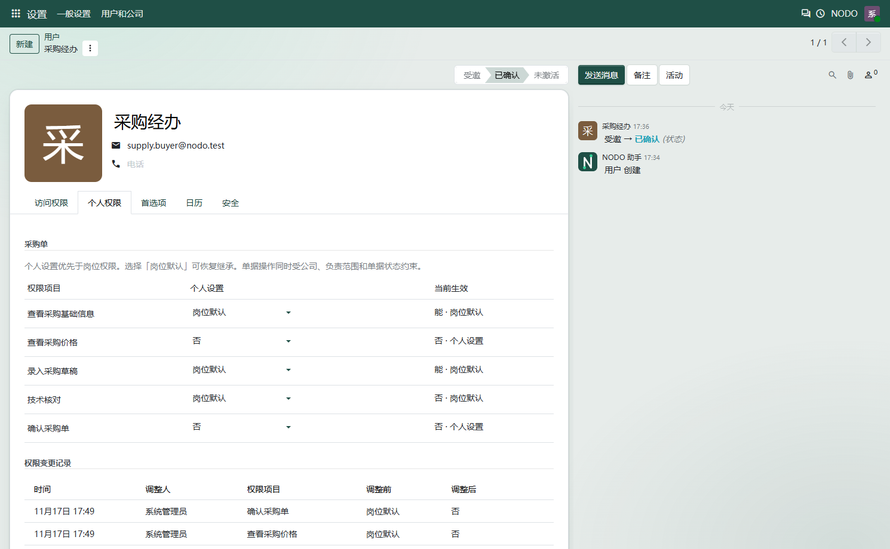

# 采购权限配置

适用 `nodo_supply`。2026-11-17 核对管理员入口、五项权限和生效来源。本页给具有系统管理员权限的人员使用。

## 给员工分配岗位

1. 进入「设置 → 用户和公司 → 用户」，打开要配置的员工档案。
2. 在「访问权限」核对员工的公司范围。采购相关人员在「NODO 角色」的「采购岗位」选择采购助理、采购或采购经理。技术人员按实际职责分配「技术」角色。
3. 保存后打开「个人权限」，查看每项「当前生效」的结果及来源。
4. 用员工的独立会话刷新并打开「采购协作 → 采购单」。使用一张对应范围内的虚构单据核对。

| 岗位 | 默认单据范围和操作 |
|---|---|
| 采购助理 | 本人录入且当前仍为草稿的采购单。可录入、修改和查价。 |
| 采购或采购经理 | 授权公司内的采购单。可查价、录改草稿、分派技术和最终确认。 |
| 技术 | 分派给自己的采购单。可查价和记录规格核对。负责技术人员由采购岗位在单据上分配。 |

完整口径见[权限矩阵](../../权限矩阵.md)。

## 维护供应商

在「采购 → 订单 → 供应商」建立或核对供应商档案。创建时系统给该联系人供应商标记。保存后，采购单可以选择在单据公司可用的启用供应商。录单人员从候选中选取，若供应商已停用，请先核对是否适合恢复或更换。

## 给个人开关权限

1. 在同一用户档案打开「个人权限」。
2. 可逐项设置「查看采购基础信息」「查看采购价格」「录入采购草稿」「技术核对」和「确认采购单」。
3. 选择「能」允许该项操作，选择「否」收回该项，选择「岗位默认」恢复继承。个人设定在兼岗时仍优先。关闭基础查看时，依赖它的采购操作也失效。
4. 点左上方云朵上箭头「手动保存」。核对「当前生效」栏，并在下方「权限变更记录」检查时间、调整人和前后值。
5. 请员工刷新页面。开启操作后的范围仍按获授权公司、草稿录入人或负责技术人员及当前单据状态判定。

## 核对关闭和恢复

在匿名账号的一张未确认草稿上检查。先记下员工当前的设置，关闭「查看采购价格」和「确认采购单」并保存。员工刷新后应能看到规格和数量，金额及确认按钮收起。恢复到刚才记录的设定，保存后再刷新同一张草稿检查。

从审计记录核对这两次操作。员工看不到采购单时先查看「查看采购基础信息」、所在公司和负责范围。助理还要核对单据是否已经离开草稿状态。需要复核服务端行为时，参考[采购协作权限验收](../../验收/采购协作权限验收.md)。
