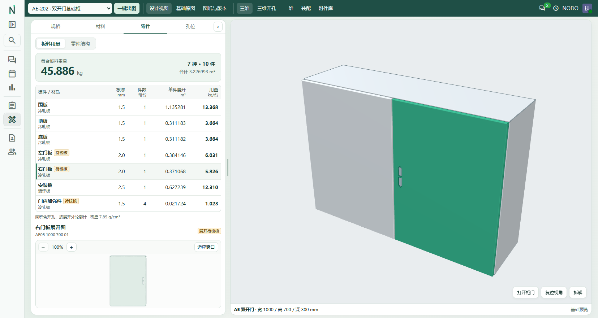
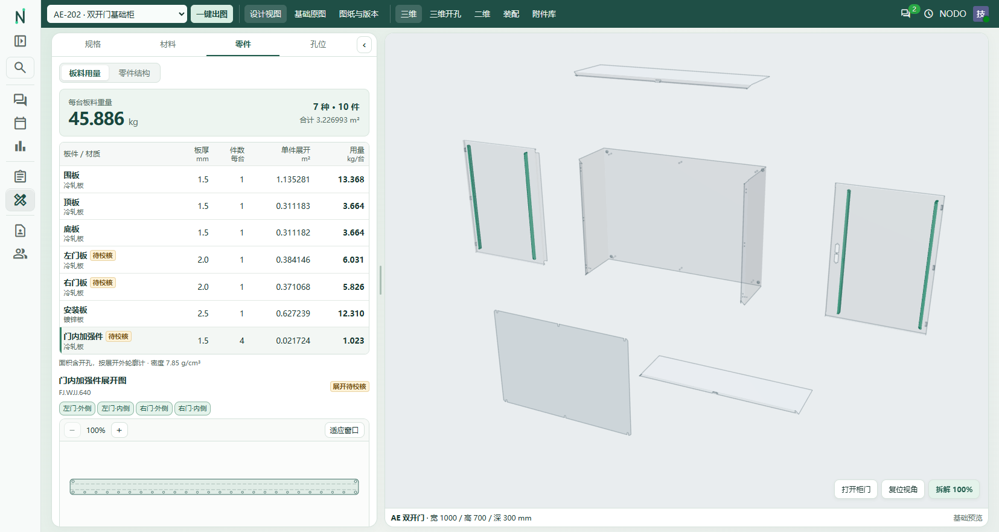

# 67 · AE-202 板料用量

2026-11-23 在本机 NODO 开发库，以技术岗位打开「技术工作台 → AE-202 · 双开门基础柜 → 零件 → 板料用量」。样柜宽 1000、深 300、高 700 mm。每台共 7 种 10 件，按当前展开外轮廓计 3.226993 m²、45.886 kg。

## 每台明细

| 板件 | 板厚 mm | 件数 | 单件展开 m² | 每台重量 kg | 展开依据 |
| --- | ---: | ---: | ---: | ---: | --- |
| 围板 | 1.5 | 1 | 1.135281 | 13.368 | 有原图依据 |
| 顶板 | 1.5 | 1 | 0.311183 | 3.664 | 有原图依据 |
| 底板 | 1.5 | 1 | 0.311182 | 3.664 | 有原图依据 |
| 左门板 | 2.0 | 1 | 0.384146 | 6.031 | 展开待校核 |
| 右门板 | 2.0 | 1 | 0.371068 | 5.826 | 展开待校核 |
| 安装板 | 2.5 | 1 | 0.627239 | 12.310 | 有原图依据 |
| 门内加强件 | 1.5 | 4 | 0.021724 | 1.023 | 展开待校核 |

面积使用切割 DXF 对应展开面的完整外轮廓，保留边缘实际形状，内部开孔和开窗计入板料。每行重量取未舍入的单件面积（m²）× 板厚（mm）× 7.85 × 每台件数，整柜合计后取三位小数。左门板、右门板和门内加强件缺独立展开原图，本次重量包含三项的当前模型值。板材排版利用率和板间余料不在此数内。

## 实测

- 逐行点选，七张展开矢量图均可读取。浏览器截图核对到七种不同的三维选中结果，每个都有可见的绿色高亮。
- 点「门内加强件」，同时高亮左右门内的四件。分别点击左门外侧、左门内侧、右门外侧和右门内侧时，各自单独选中。「零件结构」也能读到同一组选择。
- 展开图可放大到 125%，点「适应窗口」后可返回全图。修改未保存的宽度后，页面隐藏旧用量，重新打开已保存的设计仍得到原清单。验收前后设计编辑号、规格和出图版本列表一致。
- 在临时的右门模型内新增一个 Ø18 mm 圆孔。实体展开面积减少 254.469005 mm²，展开图出现新孔，取料面积和每台重量保持一致。临时模型未写回工作台。
- `nodo_draw` 模块测试 17 项通过。权限用例覆盖非技术岗位和其他工程师的私有任务，另核对了过期编辑号、未完成模型和同一预览重复打开。





### 复验命令

从仓库根目录运行。浏览器脚本使用本机已有的技术岗位会话和 Playwright。几何脚本读取标准 AE-202 的预览 mesh.json，并在临时目录中计算。

```powershell
.\scripts\nodo.ps1 test nodo_draw
node scripts/draw/verify_sheet_usage.cjs
$meshPath = Read-Host '输入标准 AE-202 的 mesh.json 完整路径'
uv tool run --offline --no-config --managed-python --python 3.13 --from cadgen==0.7.26 python scripts/draw/verify_sheet_usage_geometry.py $meshPath
```
