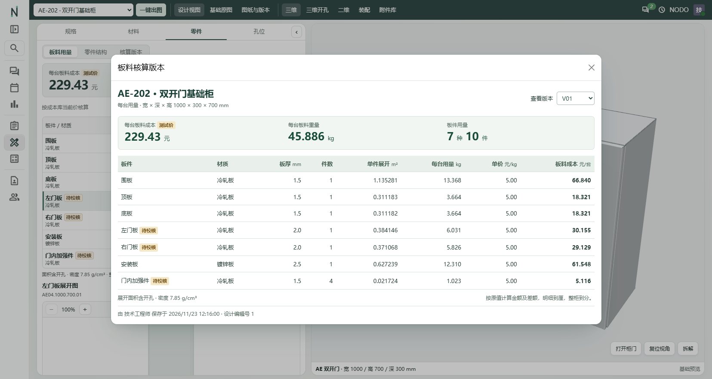
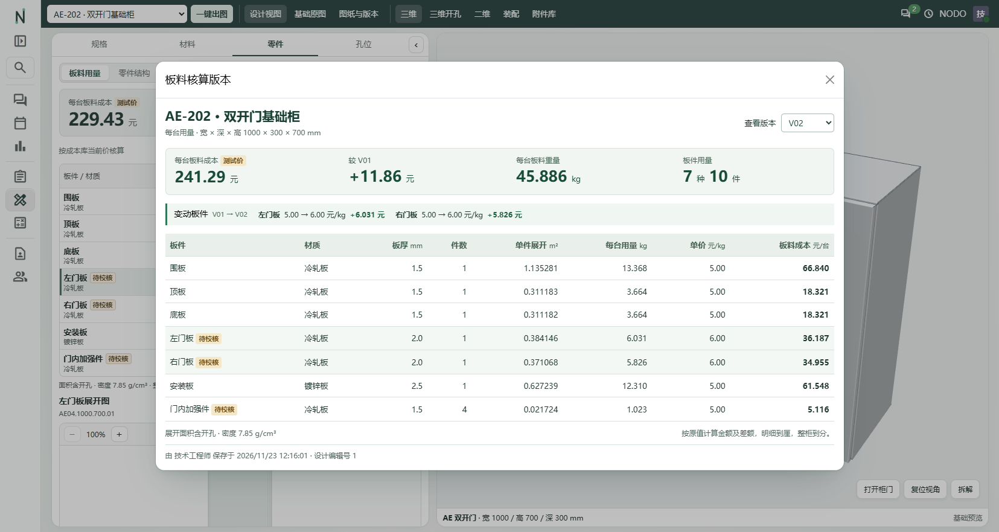
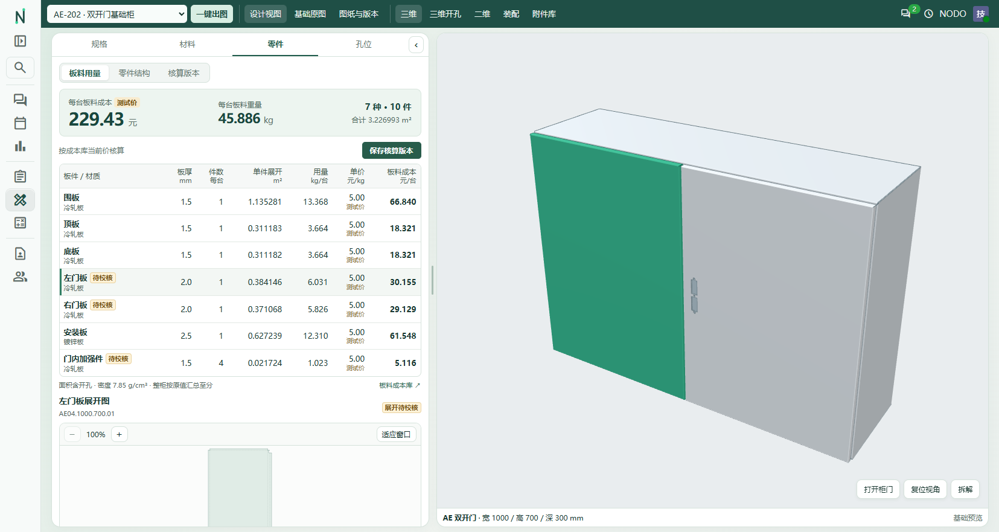

# 69 · AE-202 板料核算版本

2026-11-23 在本机 NODO 开发库，用技术、核算两个岗位走通了保存、改价、恢复价格和重新打开版本。样柜为「AE-202 · 双开门基础柜」，宽 × 深 × 高为 1000 × 300 × 700 mm。以下金额均为每台板料测试成本。

| 板件 | V01 成本（元） | V02 成本（元） | 差额（元） |
| --- | ---: | ---: | ---: |
| 围板 | 66.840 | 66.840 | 0.000 |
| 顶板 | 18.321 | 18.321 | 0.000 |
| 底板 | 18.321 | 18.321 | 0.000 |
| 左门板 | 30.155 | 36.187 | +6.031 |
| 右门板 | 29.129 | 34.955 | +5.826 |
| 安装板 | 61.548 | 61.548 | 0.000 |
| 门内加强件（4 件） | 5.116 | 5.116 | 0.000 |
| **每台合计** | **229.43** | **241.29** | **+11.86** |

成本按展开外轮廓计料，开孔面积计入，密度 7.85 g/cm³。两版均为 7 种、10 件、45.886 kg。两扇门每公斤上涨 1 元，分别增加 6.031095738… 元和 5.825763423… 元。逐件差额按两版原值算到厘，整柜金额算到分。左门板、右门板和门内加强件的独立展开原图仍待补齐，两版均逐行保留「待校核」。

## 本机操作

1. 技术员打开「技术工作台 → AE-202 → 零件 → 板料用量」，三种板材的测试价均为 5 元/kg。点「保存核算版本」，打开 V01，合计 229.43 元。
2. 核算员在原价格记录内将 2.0 mm 冷轧板改为 6 元/kg。技术员看到实时合计 241.29 元，再点「保存核算版本」。V02 的「变动板件」只列左右门板。
3. 核算员把同一条测试价恢复到 5 元/kg。回读三条样柜价格，规格、单价和价格性质均与验收前一致。
4. 关闭工作台页面，重新打开同一台柜体。实时用量表回到 229.43 元。点「核算版本」，依次打开 V01 和 V02，逐行核对两版的七行金额、三项待校核、版次、保存人和保存时间。设计编辑号仍为 1，前后柜体参数与出图任务列表一致。

## 针对性检查

`scripts/nodo.ps1 test nodo_draw_cost` 在一次性测试库运行 4 项，全部通过。用例覆盖实时取价、重复保存、价格或设计已变化、缺价、私有文件清理后的历史回看，以及按设计、公司和岗位限制访问。

`node scripts/draw/verify_sheet_cost_versions.cjs` 使用本机 Chrome 和两个岗位实测。第一次创建 V01、V02。再次运行时，脚本先检查现有历史和三条测试价，再重新打开页面核对与截图，保留现有版次。销售报价和出图流程均不在本次验收范围。
