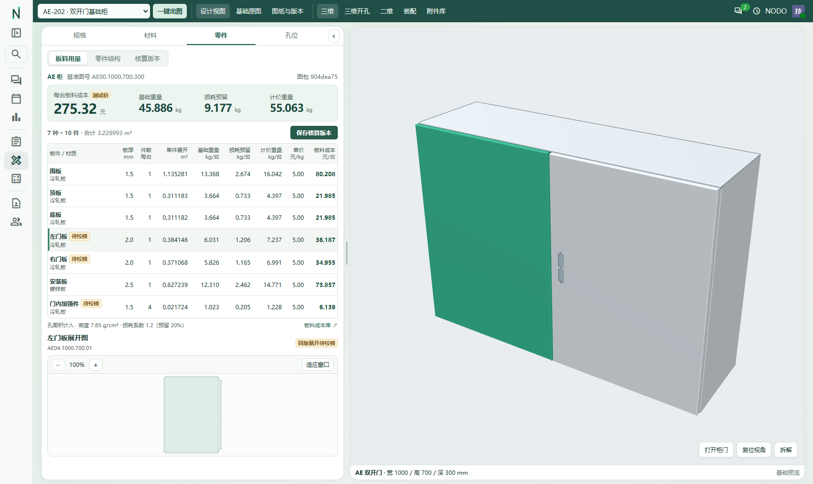
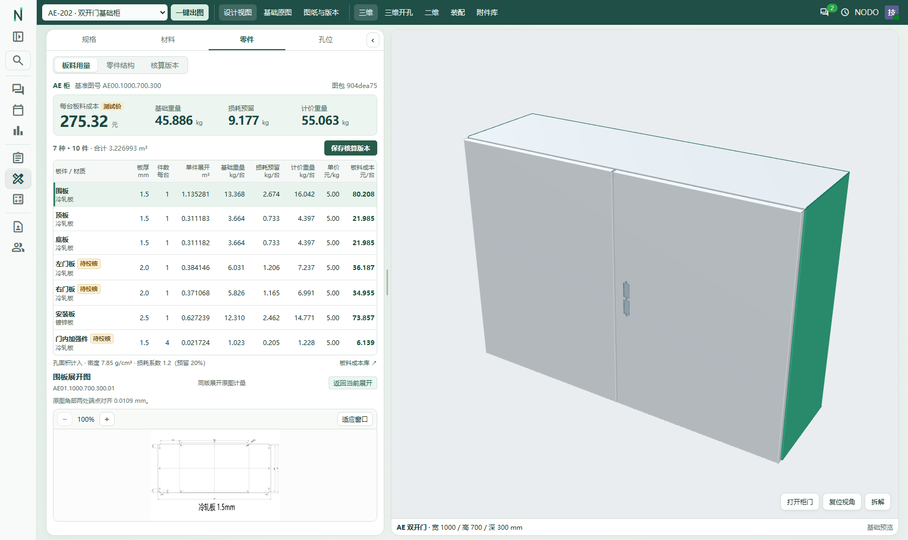
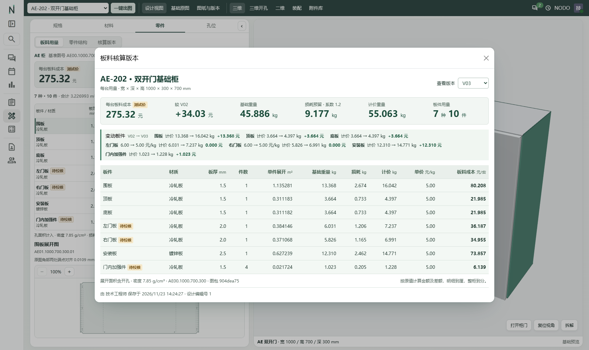

# 70 · 统一 AE 柜展开板料核算

2026-11-23，在本机 NODO 开发库以技术岗位打开「AE-202 · 双开门基础柜 → 零件 → 板料用量」。柜体宽 1000、深 300、高 700 mm。总装图号为 AE00.1000.700.300，归档 DWG 图包内容标识为 `904dea75`。本次只核算每台柜体板料，底座属于附件。

## 每台板料

单件展开取外轮廓面积，内部孔和开窗计入。行基础重量为单件面积（m²）× 板厚（mm）× 7.85 × 件数。损耗预留按基础重量的 20% 计算，计价重量为两者之和。冷轧板和镀锌板本次均使用成本库的 **5.00 元/kg 测试价**。

| 板件 | 板厚 mm | 件数 | 单件展开 m² | 基础 kg | 预留 kg | 计价 kg | 金额 元 | 面积依据 |
|---|---:|---:|---:|---:|---:|---:|---:|---|
| 围板 | 1.5 | 1 | 1.135281 | 13.368 | 2.674 | 16.042 | 80.208 | 同版展开原图 |
| 顶板 | 1.5 | 1 | 0.311183 | 3.664 | 0.733 | 4.397 | 21.985 | 同版展开原图 |
| 底板 | 1.5 | 1 | 0.311182 | 3.664 | 0.733 | 4.397 | 21.985 | 同版展开原图 |
| 左门板 | 2.0 | 1 | 0.384146 | 6.031 | 1.206 | 7.237 | 36.187 | 当前模型展开，待校核 |
| 右门板 | 2.0 | 1 | 0.371068 | 5.826 | 1.165 | 6.991 | 34.955 | 当前模型展开，待校核 |
| 安装板 | 2.5 | 1 | 0.627239 | 12.310 | 2.462 | 14.771 | 73.857 | 同版展开原图 |
| 门内加强件 | 1.5 | 4 | 0.021724 | 1.023 | 0.205 | 1.228 | 6.139 | 当前模型展开，待校核 |
| **每台合计** | | **10** | **3.226993 合计** | **45.886** | **9.177** | **55.063** | **275.32** | **7 种** |

按未舍入数汇总。四种同版展开原图对应 198.04 元，三种待校核板件对应 77.28 元。1.2 为人为设定的损耗系数，实际损耗率仍需排版单或领退料记录验证。

## 原图依据

- 当前图包以切割层及毫米单位量取外轮廓。顶、底板保留原始样条和边缘形状。围板原图存在重复线，右下角七段连续轮廓在两端错开 0.010904 mm。按该图版的水平基准刚性对齐后形成闭合轮廓，用量表可查看这项修正和原图。
- 同包左、右门板及弯角件给出成形图。京能另有同图号 EXB 左右门展开，尚缺该零件图版与当前 DWG 包对应的证据。本次以工作台当前模型展开暂计三项。
- 用户指定的 20% 预留只作用一次。对标准右门新增一个直径 18 mm 的内部圆孔，净面减少约 254.469 mm²，基础计料面积和重量在浮点公差内相同。

## 本机岗位复验

1. 从 AE-202 的零件页逐行核对件数、面积、基础重量、损耗、计价重量、5 元/kg 单价和金额。选中左门板，三维和展开预览同步。选中围板并点「查看展开原图」，核对同包参考页。
2. 点「保存核算版本」得到 V03。重新从该柜体入口进入，再打开「核算版本」，七行、三项待校核、损耗系数及 275.32 元均可回读。连续保存相同结果复用 V03。V01、V02 原始快照完整保留，回读为 229.43 和 241.29 元。柜体设计编辑号和设计参数未发生变化。
3. 运行 `scripts/nodo.ps1 test nodo_draw` 通过 18 项，`scripts/nodo.ps1 test nodo_draw_cost` 通过 5 项，均为 0 失败、0 错误。CAD 用 `scripts/draw/verify_sheet_usage_geometry.py` 核对外轮廓、内孔和来源，浏览器用 `scripts/draw/verify_ae_sheet_allowance.cjs` 对照实际行数据及保存版本。另以现有单门模型核实 5 张独立展开原图及零件图号不符处理。

直接打开该柜体链接可进入零件页。浏览器刷新通用工作台首页时会回到默认设计，重新选择 AE-202 可继续查看已保存的 V03。[本机 AE-202 板料用量](http://127.0.0.1:8079/odoo/technical-workbench?design=9&tab=parts)

