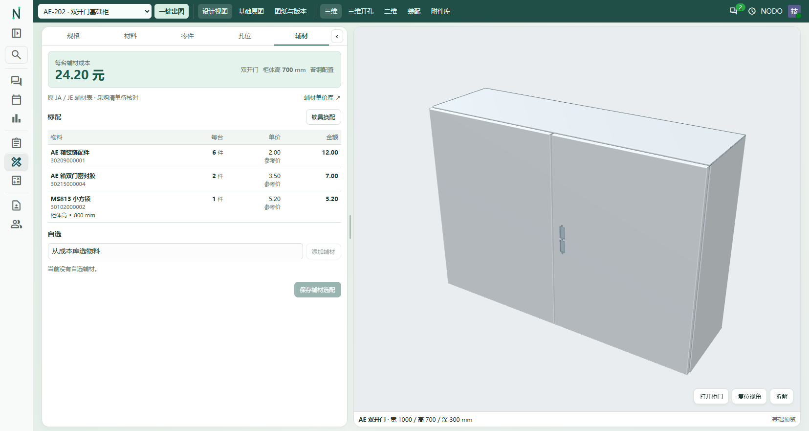
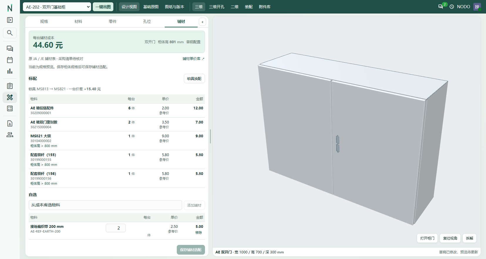
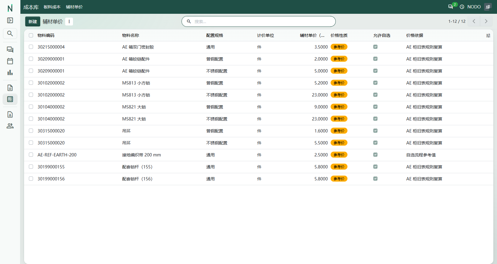

# 71 · AE 柜辅材核算

2026-11-24，本机 NODO 开发库。技术员从「技术工作台 → AE-202 · 双开门基础柜 → 辅材」核算每台用量。核算员从「成本库 → 辅材单价」维护价格。

## 规则与取价依据

| 项目 | 原 JA／JE 辅材表规则 |
| --- | --- |
| 铰链配件 `30209000001` | 单门每台 3 件，双门每台 6 件 |
| 双门密封胶 `30215000004` | 双门每台 2 件 |
| 锁具组合 | 柜体本体高 ≤800 mm 采用 MS813。>800 mm 采用 MS821 和两种锁杆，各 1 件 |
| 吊环 | 单门柜体本体高 >1000 mm 时，每台 2 件 |

参考配置按原表复算。编码 `30209000001` 的参考价对应铰链配件，图纸里的铰链管编码为 `30209000002`，采购范围和单价分别核对。锁具、密封件及结构五金的实际供货清单待确认。订单选配底座可按其采购规格列入随柜交接清单。

## 本机复验结果

| 场景 | 每台金额或状态 |
| --- | --- |
| AE-202 的 700 mm 或 800 mm 普钢双门标配 | 24.20 元，MS813 ×1 |
| 801 mm 同配置标配 | 39.60 元，换成 MS821 与两根锁杆，锁具价差 +15.40 元 |
| 自选接地编织带 2 件，每件 2.50 元 | 700 mm 合计 29.20 元，801 mm 合计 44.60 元 |
| 自选单价改为 3.00 元 | 700 mm 立即重算为 30.20 元 |
| 自选单价清空 | 该行待补价，已计价小计 24.20 元 |

自动标准数量固定。手工自选保存每台增购数量。规格变化后复核自选适用性。锁具换配由技术填写依据并保存整组，柜体规格变化后需确认沿用或恢复规则计算。交接与标配同编码同数量时归集一次，冲突时提示核对。

在实际页面验证了自选保存和重开、换配保存和重开、实时改价、缺价、恢复参照价格和原选配。801 mm 截图为未保存的计价预览，右侧保留已保存的 700 mm 三维。验收结束时样柜保存高度为 700 mm，辅材参考小计为 24.20 元。重读板料核算 V01、V02、V03，金额分别为 229.43、241.29、275.32 元。

## 核对命令

- `scripts/nodo.ps1 test nodo_cost`，5 项通过。
- `scripts/nodo.ps1 test nodo_draw_cost`，11 项通过。覆盖柜高边界、单门吊环、换配、用量保存、独立辅材修订号、取价、交接数量归集和公司权限。
- `node scripts/draw/verify_auxiliary_cost.cjs`，在 Chrome 以技术员和核算员回读实际工作台与单价库。

