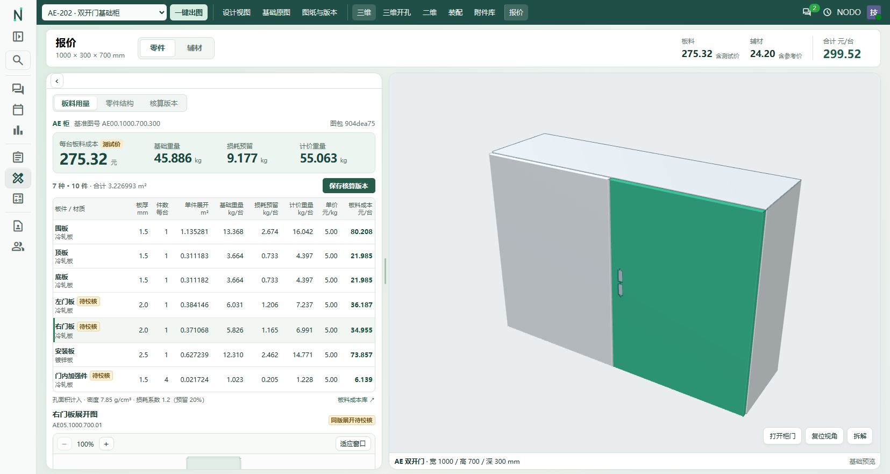
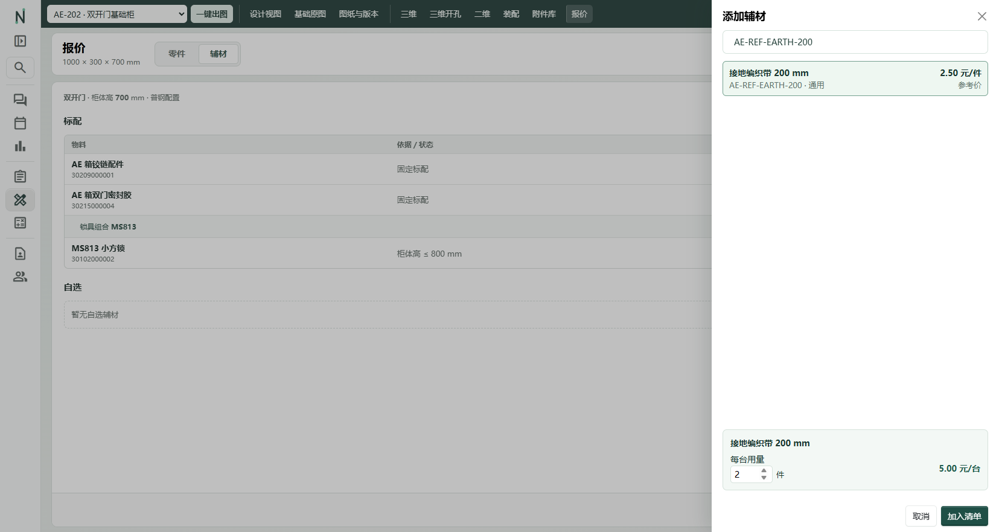
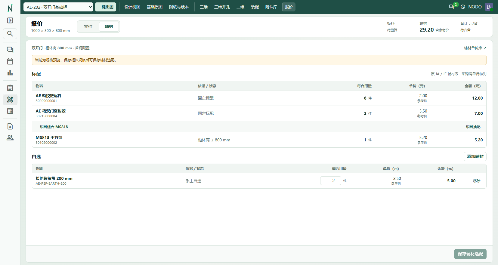
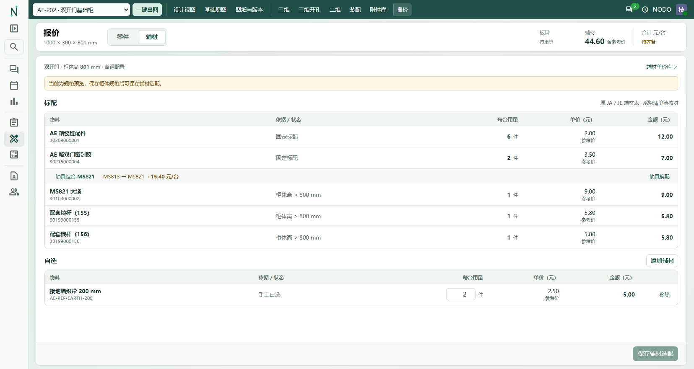
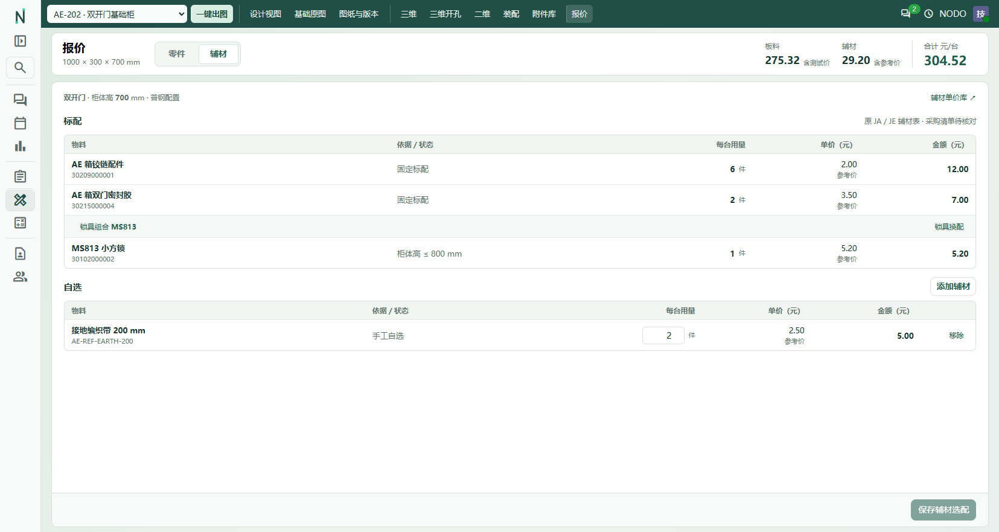

# 72 · AE 柜报价工作区

2026-11-24 · 本机开发库 `nodo_dev` · 技术工程师 · AE-202 双开门柜

## 入口与零件

技术工作台顶栏「附件库」右侧打开「报价」，在「零件」和「辅材」之间切换。设计栏提供「规格」「材料」「孔位」。在「零件」选中右门板，三维高亮右门，当前展开图可加载。「零件结构」切回「板料用量」后保留该板件的选中状态。

柜体规格为 1000 × 300 × 700 mm（宽 × 深 × 高）。板料用量为 7 种 10 件、45.886 kg，按 1.2 系数计价为 55.063 kg。使用 5 元/kg 的测试价，板料 275.32 元/台，标配辅材按参考价为 24.20 元/台，合计 299.52 元/台。左门板、右门板、门内加强件显示「待校核」。

## 自选与锁具

1. 「辅材」占满工作区。点「添加辅材」打开贴右抽屉，可按名称和物料编码搜索。「取消」关闭后清单不产生新行。
2. 选中接地编织带 `AE-REF-EARTH-200`。参考单价 2.50 元/件，整件行校验用量为正整数。输入 2，抽屉显示 5.00 元/台。「加入清单」后切到零件再返回，自选行仍在草稿中。
3. 保存后重新打开柜体，接地编织带仍为 2 件/台，辅材 29.20 元/台。当前规格板料与辅材合计 304.52 元/台。
4. 从「设计视图 → 规格」修改柜体本体高。800 mm 和 801 mm 都用规格预览核对，板料显示「待重算」，合计显示「待齐备」。

| 柜体本体高 | 标配锁具 | 标配辅材（元/台） | 含 2 件自选（元/台） |
|---|---|---:|---:|
| 800 mm | MS813 小方锁 1 件 | 24.20 | 29.20 |
| 801 mm | MS821 大锁 1 件，配套锁杆 155、156 各 1 件 | 39.60 | 44.60 |

800 mm 到 801 mm 的价差为 15.40 元/台。回到 700 mm 已保存规格后移除验收自选并保存。回读确认柜体编辑号、本体高和已保存选配与验收前一致。

## 验证范围

- `scripts/nodo.ps1 test nodo_draw_cost`，12 项通过，含成本权限、适用目录、锁具阈值及版本快照。
- `scripts/nodo.ps1 test nodo_draw`，18 项通过，覆盖技术工作台服务端。
- `node scripts/draw/verify_auxiliary_cost.cjs --quote-workspace`，使用技术工程师会话验证上述实际网页流程。
- 本轮验收覆盖本机技术工作台。成本库改价、销售报价和 CAD 全量重新生成沿用各自的专项验证范围。
