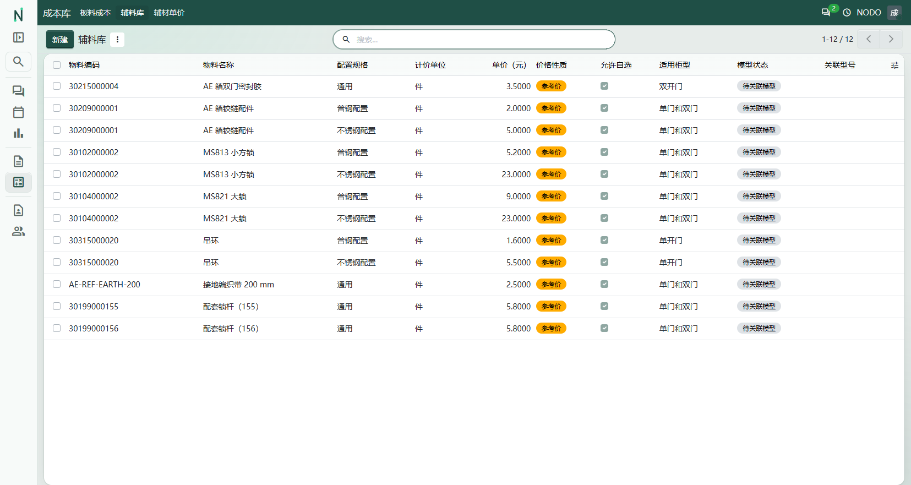
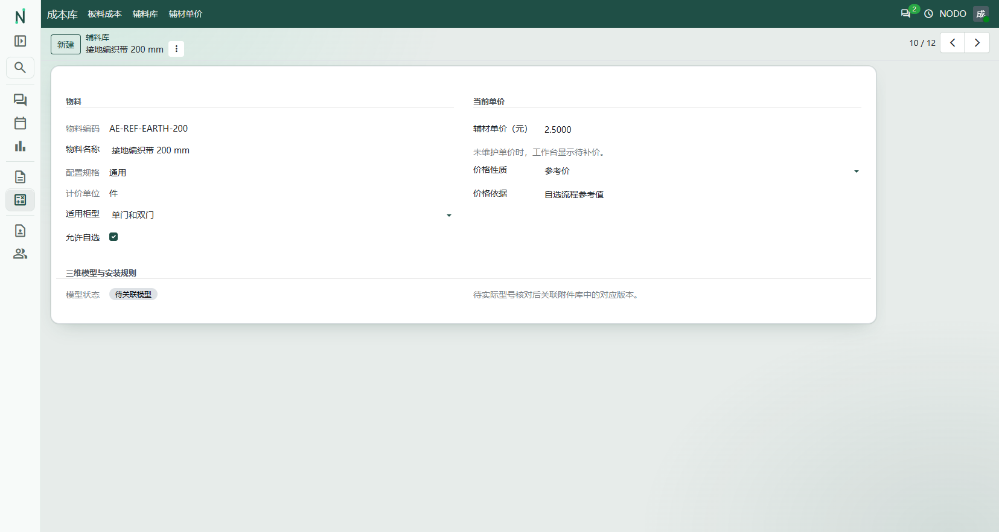
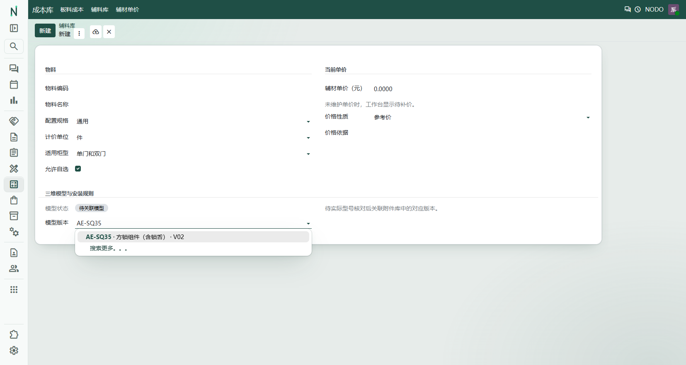

# 73 · 辅料库与模型版本

2026-11-24 · 本机开发库 `nodo_dev`

## 使用入口

「成本库 → 辅料库」展示辅料的采购编码、规格、计价单位、现价和模型状态。「辅料库」与「辅材单价」共用价格档案。技术工作台的「报价 → 辅材」可直接打开辅料库。

## 实际核对

| 账号 | 操作 | 结果 |
|---|---|---|
| 核算员 | 从成本库进入辅料库，打开接地编织带 `AE-REF-EARTH-200` | 辅料库和辅材单价均取参考价 2.50 元/件，档案显示「待关联模型」 |
| 技术员 | 从 AE-202 的「报价 → 辅材」进入辅料库，再检查右侧选料抽屉 | 辅料档案只读，自选物料仍取同一档案的 2.50 元/件 |
| 管理员 | 在辅料档案的模型版本选框查询现有附件型号 | 查询项展示编码、型号名称和具体版次。网页验收只查询，未写入关联 |

## 版本约束

附件模型按具体版本关联。存在新版时，已关联的版本继续可追溯。模型停用后，档案显示「模型已停用」。已选模型的安装规则由附件库提供，技术员可在档案所属公司查看。

- `scripts/nodo.ps1 test nodo_cost` 通过 6 项。验证成本库可独立安装及两入口共用价格模型。
- `scripts/nodo.ps1 test nodo_draw_cost` 通过 15 项。验证同公司精确版次关联、停用状态、技术查看和价格权限。
- `node scripts/draw/verify_auxiliary_library.cjs` 实际网页验收通过，覆盖三岗位及 AE-202 选料价格。正式模型资料导入和随柜装配留到模型接入时验证。
