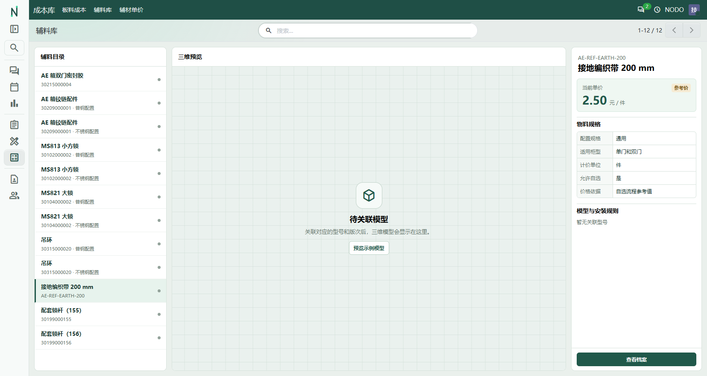
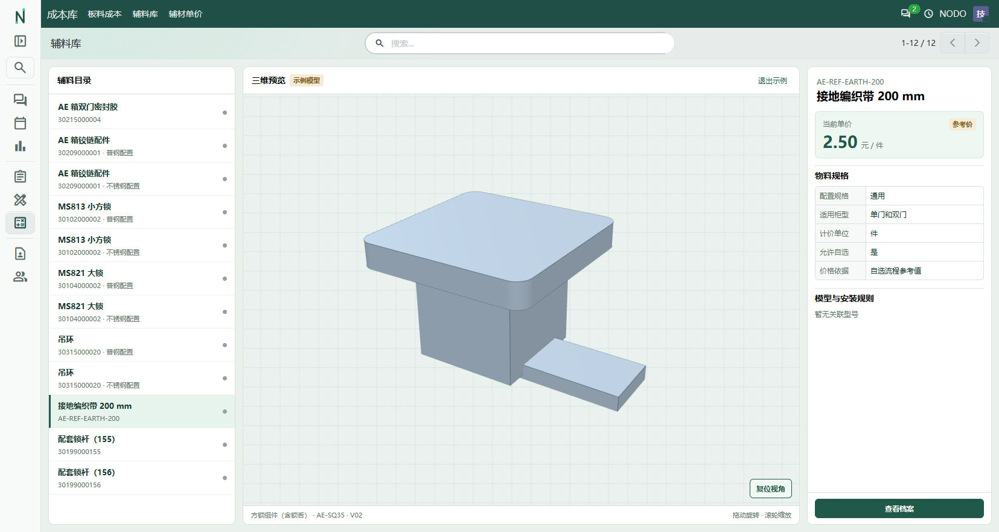
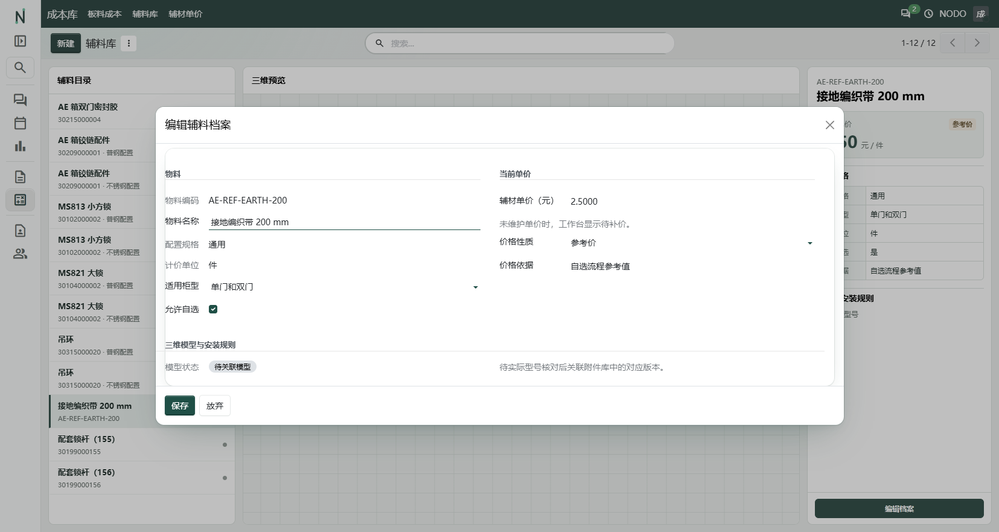

# 74 · 辅料库三维预览

2026-11-24 · 本机开发库 `nodo_dev`

「成本库 → 辅料库」使用左侧目录、中间三维视口、右侧价格与档案摘要。顶部复用原有搜索和筛选。点选物料时同屏更新内容。核算员点「编辑档案」维护价格，技术员点「查看档案」核对数据。

## 浏览器验收

1. 在技术员会话从 AE-202 报价页打开辅料库。选中接地编织带，视口显示「待关联模型」。右侧显示原参考价 2.50 元/件、计价依据和适用柜型。
2. 点「预览示例模型」。视口读取附件库可预览的方锁组件 `AE-SQ35 · V02`，标题标记「示例模型」，底部列出型号与版次。
3. 实际拖动旋转和滚轮缩放，对比模型画面验证变化。点「复位视角」后，模型恢复初始取景。
4. 点「退出示例」或切换物料后，恢复对应物料的预览状态。回读确认验收样料仍为待关联，现价和记录 ID 与验收前一致。
5. 核算员可从右侧打开可编辑档案，技术员打开的是只读表单。管理员在草稿中可按编码查询具体模型版本。原附件库入口和报价选料抽屉可继续打开。

## 服务端核对

- `scripts/nodo.ps1 test nodo_draw_cost` 通过 15 项。使用隔离数据验证按已绑定版次返回预览、权限限制、缺少预览文件及已停用状态。
- `node scripts/draw/verify_auxiliary_library.cjs` 通过上述实际网页验收。三维操作使用附件库现有资产。正式辅料与实际 CAD 的绑定留到型号核对后。
