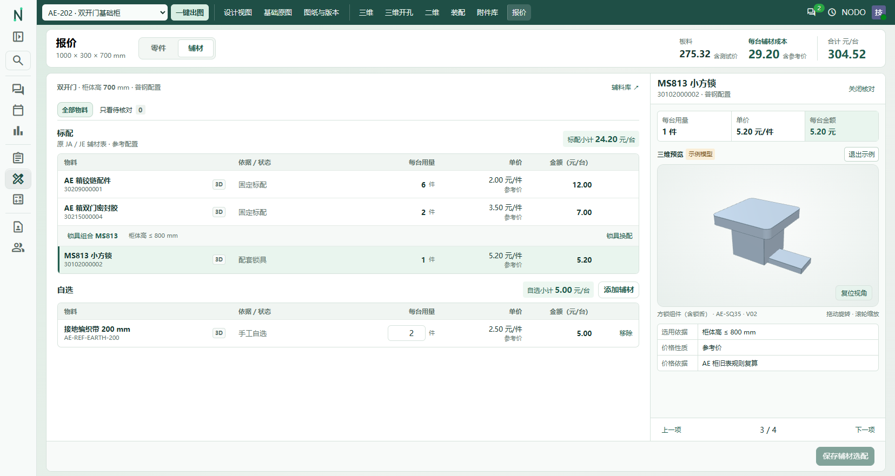
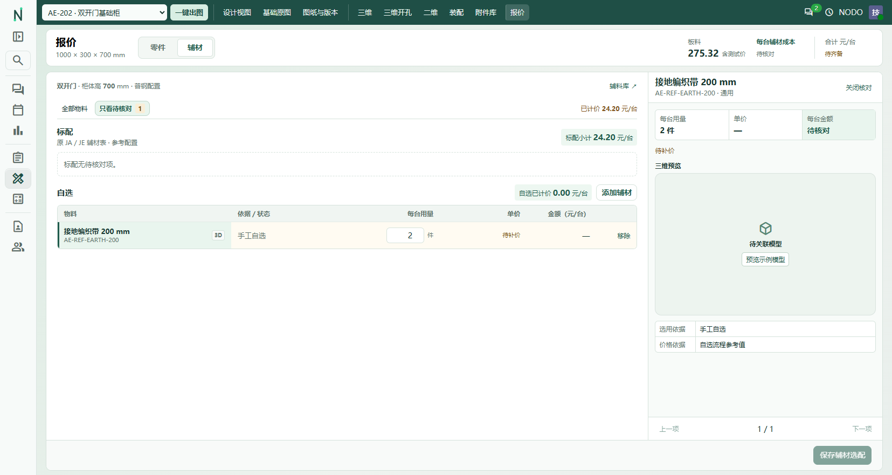
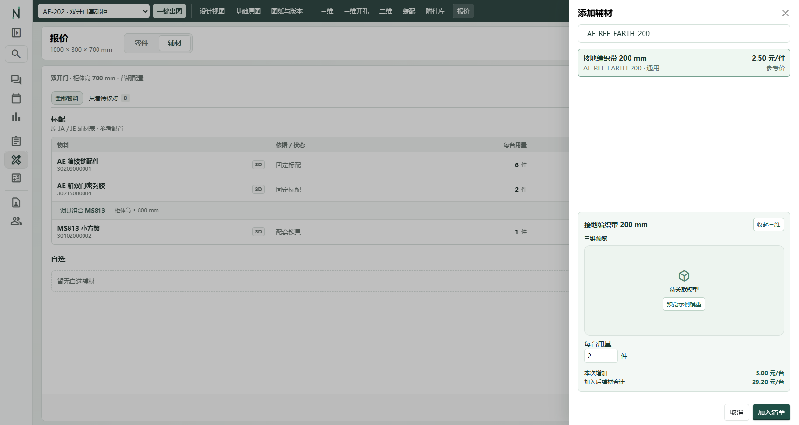
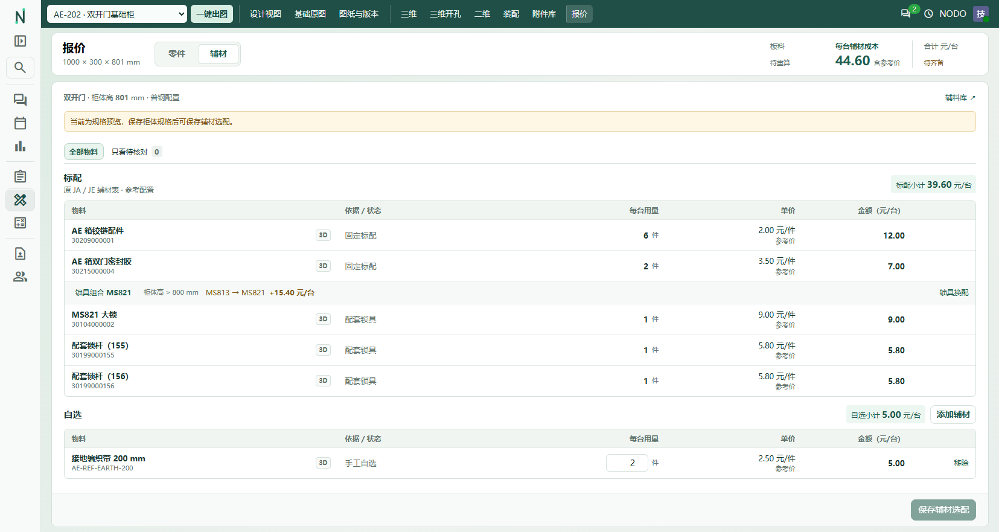

# 75 · 辅材逐项核对与三维预览

2026-11-24 · 本机开发库 `nodo_dev` · 技术工作台 → 报价 → 辅材

## AE-202 浏览器验收

| 操作 | 实际结果 |
| --- | --- |
| 打开 700 mm 双门柜辅材清单 | 标配小计 24.20 元/台，标配和自选使用相同的数量、单价和金额列。 |
| 点击物料名称或「3D」，再切换上一项、下一项 | 右侧随当前物料更新数量、单价、金额、适用条件和三维状态。待关联的物料可以打开明确标记的 `AE-SQ35 · V02` 示例模型。拖动、滚轮缩放和复位均在浏览器核对。 |
| 打开选料抽屉并把接地编织带数量设为 2 件 | 抽屉显示价格与三维关联状态，增加 5.00 元/台，加入后 29.20 元/台。加入并保存，重新打开后自选项、数量和金额仍在。 |
| 核对 800 mm 和 801 mm 的换锁边界 | 800 mm 使用 MS813，合计 29.20 元/台。801 mm 使用 MS821 和两种配套锁杆，标配小计 39.60 元/台，合计 44.60 元/台，换锁差额 15.40 元/台。 |
| 暂时清除验收辅材的参考价，开启「只看待核对」 | 筛选保留并定位到接地编织带一项，显示缺价原因和已计金额 24.20 元/台。 |
| 恢复验收样料 | 回读确认参考价恢复为 2.50 元/件，本次新增的自选项已移除，柜高恢复为 700 mm。 |

## 验证范围

- `scripts/nodo.ps1 test nodo_draw_cost` 通过 16 项，覆盖辅材选配、价格汇总及取整尾差、多公司权限与指定版本的预览查询。
- `node scripts/draw/verify_auxiliary_cost.cjs --review` 通过上述网页流程。网页中的实际三维画面来自附件库现有示例。业务辅材关联正式 CAD 后，按指定的模型版次加载。正式模型的匹配留待对应资料齐备后验收。
